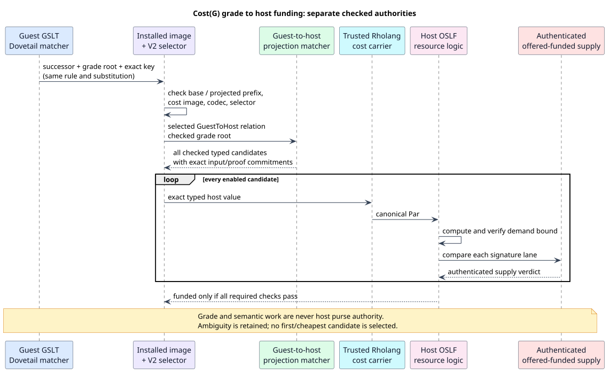

# OSLF integration: formal contract and verification boundaries

OSLF means *Operational Semantics in Logical Form*. It derives a language's
observational logic from its operational presentation. A graph-structured
lambda theory (GSLT) supplies the terms, equations, and rewrites. Cost(G) adds
graded resource behavior to that presentation. Native monetary settlement is
a separate check. These components compose, but their evidence is not interchangeable.

This page indexes the integration's formal obligations. It distinguishes
mathematical results, bounded model checks, executable tests, and remaining
implementation correspondence. A checked component theorem is not a proof
that every node execution satisfies its premises.

## Cost-accounting boundary

Cost accounting meters communication reductions (COMMs) for computation
and bytes for storage. Decoder operations, temporary heap allocations,
and replay traversal do not introduce additional cost-accounting meters.

Replay host-work reservations and their accounting profiles are not OSLF
integration requirements. Their removal must preserve stack-safe codecs,
canonical validation, authenticated codec selection, and economic charges.
The implementation cleanup is in progress. Historical reservation results
do not establish a current acceptance requirement or certify that cleanup.
This document does not claim that all inherited metering has been removed.

Funding projection and settlement retain their existing responsibilities.
They validate resource evidence, permissions, signed prices, and signed
limits against the computation and storage charges. This boundary does
not remove unrelated parser or language-installation security controls.

## The end-to-end contract

An installed language fixes its grammar, semantic image, cost image, projection,
and trusted host interpretation. The existing matcher produces successor and
grade evidence under the same substitution. It must retain every enabled
candidate until justified evidence rejects that candidate.

A funding projection interprets the grade as a typed host term. It does not
create a wallet, token, capability, or monetary charge. The native resource
logic checks the host demand evidence. An authenticated native prefix must
support the resulting resource judgment. Native settlement separately checks
the actual resource classes, source permissions, signed price, and signed limit.

The node stages execution privately. Publication requires live capabilities,
complete obligation records, and independent replay agreement. Refusal or
cancellation discards unpublished state. It does not erase native work already
charged by the existing accounting rules.



The [diagram source](figures/cost-g-funding-projection-v2.puml) and
[V2 contract](cost-g-funding-projection-v2.md) define the artifact boundaries.
The projection rules use the existing typed rewrite machinery. This contract
does not introduce another parser, evaluator, allocator, or monetary ledger.

## Formal and executable correspondence

| Boundary | Formal artifact and result | Implementation evidence and limit |
|---|---|---|
| Authored continued/Cost(G) witnesses | Grade-image typing, provenance, and equation exclusion have focused models. Native wrapping and morphism results have explicit source-specific premises. | Typed cut, section, wrappability, morphism, gated-rule, and declared-law references remain unauthenticated. Names alone are not proofs. |
| Source grade-row admission | [`CostSourceAdmission.v`](../../formal/rocq/runtime_grammar/theories/CostSourceAdmission.v) proves full positional roster coverage and uniqueness, and retains each source rewrite's identity, exact grade root, and grade sort through existing grade publication | Compiler properties check both equation directions, source ordering, alternate well-sorted roots, and missing, duplicate, or cross-wired rows. The proof assumes an authentic program view and its grade-expression interpretation. |
| Authored signature algebra | [`SourceSignatureMonoidAdmission.v`](../../formal/rocq/runtime_grammar/theories/SourceSignatureMonoidAdmission.v) derives associativity, commutativity, and both unit laws in the congruence generated by actual source-equation instances | The [source-law checker](../../grammar-core/src/cost_image/source_laws.rs) recognizes sufficient unconditional schemas on an already verified owner. This is not a section, faithfulness, or full Cost(G) certificate. |
| Authored rule execution and publication | [`AuthoredSourceExecution.v`](../../formal/rocq/runtime_grammar/theories/AuthoredSourceExecution.v) proves ordered completed-operation frame preservation; [`SemanticPublicationProvenance.v`](../../formal/rocq/runtime_grammar/theories/SemanticPublicationProvenance.v) proves exact candidate provenance; [`AuthoredSourcePublication.v`](../../formal/rocq/runtime_grammar/theories/AuthoredSourcePublication.v) composes them | Local matching, construction, freshness, collection, intrinsic, and guard refinement contracts remain explicit. This is not yet a proof of every physical Rust frame-stack step or independent replay of flat receipts. The checked-cost composition additionally carries cost-image identity and grade sort. |
| Freshness worklist completion | [`FreshnessWorklist.v`](../../formal/rocq/runtime_grammar/theories/FreshnessWorklist.v) proves exact successful Boolean verdicts using the existing binder-sensitive free-occurrence relation, including shared and cyclic graph views | The Rust traversal is unchanged. Canonical e-class decoding and its authored-value meaning remain representation obligations. Malformed decoding of a popped, unvisited non-needle vertex cannot yield a Boolean verdict. Needle equality is checked before decoding; shielded bodies need not be inspected. Resource or cancellation refusal is not evidence of freshness. |
| Term-construction continuation | [`AuthoredTermConstruction.v`](../../formal/rocq/runtime_grammar/theories/AuthoredTermConstruction.v) proves that a successful singleton completion realizes the exact source root under the saved environment | All current source forms and all four existing task variants are covered. Five local physical-operation contracts and the source/e-class projection remain explicit; no overall builder-soundness premise is assumed. |
| Rich resolved source/image correspondence | [`AuthoredSourceImage.v`](../../formal/rocq/runtime_grammar/theories/AuthoredSourceImage.v) proves exact indexed term/variable fields, backward/bounded references, and the connection from accepted `Slot`/`Apply`/`Map` nodes to existing construction steps | The model starts at resolved IDs. Raw-name resolution, owner-bound source interpretation, full typing, concrete checker refinement, and physical e-class contracts are not silently assumed proved. Its arena check is the term/variable slice shared by rule and judgment validation, not a substitute for whole-image validation. |
| Exact collapse-equation section | [`SourceEquationSection.v`](../../formal/rocq/runtime_grammar/theories/SourceEquationSection.v) proves termination, unique normal forms, exact schema-roster recognition, quotient invariance, and accepted-output uniqueness for the ten admitted equations | The [source-bound checker](../../grammar-core/src/source_equation_section.rs) passes generic admission properties and the full installed-Regex control. The latter checks base and projection-augmented identities separately. Exact rich-term encoding and physical saturation/extraction correspondence remain explicit obligations. The proof does not supply a continued cut or authenticate arbitrary witness strings. |
| Selected-carrier section domain | [`SourceEquationCarrierDomain.v`](../../formal/rocq/runtime_grammar/theories/SourceEquationCarrierDomain.v) proves typed equation/collection closure and mathematical completion for canonical inputs whose reachable keyed collections have equation-inert keys | The [carrier admission contract](../design/plans/oslf-authored-witness-admission.md#selected-carrier-domain-admission) maps each theorem to owner-bound signature projection and properties. Selected-sort normalization passed the 401-test library and installed Regex gates; the later carrier-admission helper passed the separate 412-test library gate and installed `Pattern`/`Computation` certificate assertions. Exact-key reflection, source projection, and physical engine correspondence remain explicit. |
| Signed source preparation | [`RholangCostPreparation.v`](../../formal/rocq/rho_bridge/theories/RholangCostPreparation.v) preserves row scope, clause metadata, final-continuation signing, and exact structural receipt bindings; a separate native-offer composition retains signed controls | After the epoch correction, all 32 located-authority tests, 20 node admission tests, 17 native-source parity tests, and 14 MeTTaIL lowering/native/replay tests passed. Earlier frontend, Casper, residue, and fixed-stack passes retain their recorded scope. Preparation supplies no native funding authority or authenticated phlo controls. |
| Authored interpretation | [Authored Cost(G) interpretation](authored-cost-interpretation.md) derives no-leak, exact whole-cut grades and seal preservation, and declared-law transport from explicit interpretation premises | A native identity/live-step instance is checked. Executable admission of arbitrary witness strings does not yet establish those premises. |
| Exact demand evidence | [`GenericDemandVerification.v`](../../../../f1r3node-rust-f1r3lang/formal/rocq/cost_accounted_rho/theories/GenericDemandVerification.v) authenticates recomputed evidence and proves funding composition | The generic trait tests use an independent finite execution oracle. Analyzer soundness for arbitrary native programs is not discharged by that finite example. |
| Native and MeTTaIL presentations | [Resource-logic conformance](oslf-resource-logic-conformance.md) maps the same checker, signatures, observations, and formulas | The adapter delegates to native code. Differential tests establish presentation parity, not absence of a shared native defect. |
| Evidence strength | [`CAOSLFSpatialModal.v`](../../../../f1r3node-rust-f1r3lang/formal/rocq/cost_accounted_rho/theories/CAOSLFSpatialModal.v) distinguishes exact demand from an upper bound | `accounting/oslf.rs` has three-valued formula evaluation. A deficient upper bound remains indeterminate, including under negation. |
| Grade ownership and candidates | [`CostGradeFundingBoundary.v`](../../formal/rocq/rho_bridge/theories/CostGradeFundingBoundary.v) preserves base-image ownership, candidate order, multiplicity, and checked receipts | The funding-preparation tests use real installed images and generated host reconstruction. Preparation alone does not authorize offered funding. |
| Finite grade interpretation | [`FiniteCostGradeFold.v`](../../formal/rocq/rho_bridge/theories/FiniteCostGradeFold.v) proves product and occurrence laws for its stated finite interpretation | The model's generators use one fixed host lane. It is not a proof of arbitrary authored projection relations. |
| Finite native template | [Finite host-template verification](finite-host-template-verification.md) connects generator occurrences to native payable atoms and exact compound coverage | Native analyzer and canonicalization correspondence is tested against the actual functions. The algebraic proof does not verify the Rust compiler or analyzer implementation. |
| Entry and normalization evidence | [Trace funding transport](cost-g-trace-transport.md) retains entry evidence, every hop, source-proof identity, selected index, and projected candidate occurrence | The kernel already emits `CheckedTraceV2`. The entry-inclusive certificate is required. Connecting its complete evidence to native funding remains a runtime obligation. |
| Authenticated supply | [Native-prefix supply](cost-g-native-prefix-supply.md) preserves custody, location, chronology, and the common-witness requirement | Physical-token feasibility and measured economics are distinct. Numeric dominance alone cannot authenticate a native prefix. |
| Checked prefix extraction | [`NativePrefixCut.v`](../../formal/rocq/rho_bridge/theories/NativePrefixCut.v) splits existing native histories without changing birth lookup or located-access predicates | Existing native tests cover stack prefixes, birth timing, and operation readiness. The runtime event-to-operation projection remains unimplemented. |
| Attempt ownership | [Staged language capabilities](staged-language-capabilities.md) specifies install, revoke, abort, reset, and replay isolation | Bounded lifecycle checks do not establish that the current offered-runtime factories implement the modeled isolation. |
| Publication and replay | [Staged guest obligations](staged-guest-funding-obligations.md) composes guest records with existing native replay and publication models, retaining one common supply witness per roster | The obligation checker has explicit completeness and authentication premises. The runtime must establish these premises at the actual execution boundary. |

The linked documents name individual theorems, tests, negative controls, and
commands. Each model must state its abstraction boundary. A successful
`Print Assumptions` report excludes hidden global axioms. It does not discharge
an explicit premise about a checker or an analyzer.

[`MettaGsltPresentation.v`](../../formal/rocq/rho_bridge/theories/MettaGsltPresentation.v)
parameterizes its key type and key function. Its traversal theorem therefore
applies to the host's key function without implementing another hash or
assuming injectivity. It characterizes emitted key triples. It does not prove
that equal keys identify a unique subterm. The adapter's actual delegation is
covered separately by its executable parity tests.

### Upper bounds cannot prove a negative funding fact

Let $`S`$ be authenticated supply, $`U`$ a conservative upper bound, and $`d`$
the actual demand at one surface. The premise is $`0\leq d\leq U`$.

| Evidence | Comparison | Sufficiency verdict |
|---|---|---|
| Exact demand | $`d\leq S`$ | Satisfied |
| Exact demand | $`S<d`$ | Unsatisfied |
| Upper bound | $`U\leq S`$ | Satisfied |
| Upper bound | $`S<U`$ | Indeterminate |

For example, supply one and upper bound two permit actual demand zero, one,
or two. The first two cases are funded. The last is not. Therefore neither
sufficiency nor its negation is established by that upper bound alone.

`sufficient_check_satisfied_iff`, `sufficient_check_unsatisfied_iff`, and
`upper_bound_shortage_has_both_concretizations` state these facts in the native
model. The capstone includes the negation-preserves-uncertainty obligation.
This does not weaken the funding gate: an indeterminate result cannot authorize
execution or publication.

## What the cited theory does not license us to claim

The [cost-accounted rho paper](rho-native-integration/references.md#cost-rho)
requires exact signature identity, wrapped substitution, complete join
participants, and resource conservation. Its static decidability statement
uses a statically known call graph. It does not justify finite certification
of arbitrary unknown recursion through an arbitrary safety margin.

The [continued-GSLT paper](rho-native-integration/references.md#cost-monad)
distinguishes interaction, continuation wrapping, signature products, and
located capabilities. A signature monoid is not automatically cancellative.
Collision resistance of a hash does not prove injectivity of an arbitrary
monoid product. Any proof that needs cancellation must establish it for the
chosen representation or state it as a separate hypothesis.

The [knotted-topoi manuscript](rho-native-integration/references.md#knotted-topoi-2026)
lists outstanding coherence, operational-correspondence, full-abstraction,
and related construction obligations. The integration must respect its stated
operational requirements. A finite runtime model does not solve those general
categorical obligations.

Likewise, a finite example of language-to-Rholang correspondence is not a
full-abstraction theorem for every language. The
[Meta-MeTTa operational semantics](https://doi.org/10.48550/arXiv.2305.17218)
motivates interaction, observation, and effort accounting. The cited paper is
by Lucius Gregory Meredith, Ben Goertzel, Jonathan Warrell, and Adam Vandervorst
(2023, arXiv version 1). A proof about a small example must not be relabeled
as a proof of the entire MeTTa semantics.

Funding adequacy also does not imply quote-faithfulness. The accepted
[finite host template](finite-host-template-verification.md#funding-adequacy-is-not-quote-faithfulness)
preserves generator multiplicity while mapping every generator to one host
lane. A behavioral morphism's signature-injectivity obligation requires
separate evidence. This funding interpretation is not that morphism.

## Explicit proof premises

A premise is an obligation at a component boundary. Kernel checking does not
make an unproved premise true. The following premises remain visible in the
formal contracts and their implementation mappings.

| Premise | Source of evidence | What the composition proves |
|---|---|---|
| An installed owner and complete match roster are authentic | Existing installed-image and matcher checks | Transport retains the exact owner, proof identities, candidate order, and multiplicity. |
| Grade interpretation preserves payable atoms | Accepted finite interpretation and canonical signature construction | The finite-template proof retains every generator occurrence through native exact coverage. |
| A host bound conservatively describes its interpretation | Native demand analyzer and verifier | Supplying a verified upper bound establishes sufficiency, not exact execution or a negative sufficiency verdict. |
| Prefix input comes from rooted native state and the original event order | Checked wallet, stack, custody, birth, and located-authority inputs | The concrete model proves capacity conservation, exact presentation, and prior-event availability for those inputs. |
| One common supply witness covers the complete roster | `roster_supply_check` and its explicit soundness contract | Staged publication cannot replace that witness with independently feasible per-candidate allocations. |
| Physical and economic evidence refer to the same invocation | Authenticated session, generation, root, prefix, operation, and ordinal | Context-indexed composition retains both obligations without creating another monetary case. |
| The expected guest journal is complete | Actual native execution and guest-invocation records | The staged checker preserves exact order and rejects omissions, duplicates, and replay differences. |
| Capabilities are live at commit | The host's locked publication check | Publication requires this guard. The abstract Boolean alone does not prove lock atomicity. |
| Replay artifacts bind the checked journal | Existing validated artifacts plus the guest-evidence commitment | A checked journal cannot authorize an unrelated artifact under the stated binding contract. |

The current runtime must still establish the unfinished input, recording, and
replay connections. The finite host-template tests provide executable evidence
for the accepted fragment. They do not establish arbitrary authored host
interpretations. A new interpretation needs its own checked adequacy contract.

### Signed preparation and native offer binding

[`RholangCostPreparation.v`](../../formal/rocq/rho_bridge/theories/RholangCostPreparation.v)
reuses `RholangCostSurface` for signature conversion and placement. A semicolon
receive first signs its authored final continuation, then nests its rows, then
expands each row's request/return sources. A later row's requests therefore
remain beneath the preceding receive. The transparent signed-continuation
marker does not add an extra wrapper. Uniform signing retains an explicit final
signature; transfer signing places the source signature outside the receive
and the target signature around its final body. An independently authored
nested `for` is itself a continuation and retains its own signing boundary.
Synthetic nesting of semicolon rows does not create those additional boundaries.

The implemented checked-query slice now admits `InputBindQuery`,
`InputBindEmptyQuery`, and `InputBindQuotedQuery` through the existing
[source-profile rows](../../languages/src/rholang/source_profile_policy.rs).
[`enter_for_rows`](../../rholang-runtime/src/rholang_ast.rs) borrows each channel
and argument slice through the existing
[`query_request`](../../languages/src/rholang/receive.rs) classifier.
[`SourceBuilder::query_returns`](../../rholang-runtime/src/rholang_ast/preparation_source.rs)
allocates fresh return binders for the current row. The receive state overrides
only each query's source with its return name, then schedules the existing
`New`, `ParFold`, send, and receive jobs. Each request prepends its own return
name to the authored payload. Later rows are prepared inside the preceding
receive's continuation, where its pattern bindings are available. This reuses
the existing worklist without copying or reparsing the source AST (abstract
syntax tree). Query preparation remains subject to the shared work/storage
budget and cancellation checks.

The 2026-10-13 source-bound implementation extends that slice through
[`RholangProgramFrontend::prepare_with_report`](../../rholang-runtime/src/rholang_ast/prepared_frontend.rs).
The actual generated `Proc::parse_via_wpda` call creates a private `ParsedSource`
containing the exact source and parsed tree. The
[`public source session`](../../rholang-runtime/src/rholang_ast/session.rs)
checks the same source profile, then passes that private value into the existing
bounded, stack-safe driver. Only this route admits signed query receives and
treats `PForCostSigned` as a transparent continuation marker. AST-only and raw
lowering retain their existing refusals for those forms. The implementation
continues to use the same borrowed rows, scopes, signatures, and continuation
jobs; the new receipt does not create another evaluator. The nineteen-test
frontend gate passed on 2026-10-13. After correcting native continuation
authority, the fourteen-test lowering/native gate also passed. The earlier
node and Casper snapshots and outstanding regression gates are recorded below.

The model's receipt compares exact source octets, the complete host-language
identity, and output octets. A grammar-only identity is insufficient. The
implementation uses the existing generated complete-definition fingerprint
as its language identity, retaining exact source and output bytes rather than
hashing them into another commitment. This is an identity-consistency check;
it does not prove fingerprint injectivity, authenticate an arbitrary frontend,
or discharge the model's parser/encoder correspondence obligations.

The node's immutable
[`PreparedProgram`](../../../../f1r3node-rust-f1r3lang/rholang/src/rust/interpreter/frontend.rs)
now optionally retains those three byte sequences beside its private `Par`.
`from_normalized_with_binding` uses the existing iterative protobuf encoder to
require exact agreement between the supplied output bytes and the retained
process. `ProgramFrontend::language_identity` declares whether the selected
frontend requires a binding. The shared `prepare_program` boundary checks the
requested source and declared language identity, refuses a missing required
binding, and refuses a binding from a frontend that declares no identity.
The legacy case in which neither declares nor supplies a binding remains
available; it does not acquire source-bound evidence. Borrowed access exposes
no mutable process or receipt, and `into_par` consumes the prepared artifact.

[`prepare_offered_source`](../../../../f1r3node-rust-f1r3lang/casper/src/rust/rholang/runtime.rs)
already calls that shared boundary for offered execution and native replay
before effects. It needs no duplicate receipt check. The frontend has no
authenticated deploy envelope, `phloPrice`, `phloLimit`, or funding authority
to put in its receipt. Existing native offer checks, execution accounting, and
publication/replay gates retain those responsibilities; this change adds no
gas schedule or monetary rule.

Receipt construction copies the source and language-identity bytes and encodes
the output with fallible allocation. The node constructor encodes the output
once more and refuses a mismatch. Allocation failure, a mismatch, or
cancellation returns no prepared artifact. Preparation has no work or
storage-unit ceiling (DR-131 extension to F1R3Lang, user decision 1 of
2026-10-16). The source-byte limit does not prove a lexer/parser work bound.

| Formal result | Implementation and property obligation |
|---|---|
| `binding_retains_authenticated_epoch_and_preimage`, `binding_preserves_any_hash_identity`, `independently_bounded_routes_preserve_source_binding` | [`NativeSourceEncoding.v`](../../../../f1r3node-rust-f1r3lang/formal/rocq/cost_accounted_rho/theories/NativeSourceEncoding.v) reuses byte-preservation results to compare successful encodings of the same source under the same supplied epoch, event-leg encoder, and outer framing. The corrected reducer obtains the epoch from its RSpace instance at all three registration sites. The 17-test native-source gate checks concrete constructor parity, framing, and budget refusals. The model does not prove that Rust supplies those encoders or authenticates the epoch. |
| `authenticated_introduction_registration_preserves_lookup`, `authenticated_stack_receipt_preserves_raw_source_lookup` | Introduction registration and observation use the same event-kind domain transform of the source hash. Stack receipts use the raw source hash instead. Both new native admission controls pass under `CostV1`/protocol 6 and `CostV2`/protocol 7. The located-authority property checks 16 generated cases in both epochs. The proofs establish immediate lookup in an abstract registry, not collision freedom, registry lifetime, or concrete resource accounting. |
| `marker_erasure_preserves_the_entire_staged_result`, `preparation_preserves_per_clause_binders_and_signatures`, `staged_rows_preserve_order_and_all_clause_metadata` | The existing receive worklist retains row order, patterns, guards, binders, and continuations. The private parsed-source route permits signed queries and transparent `PForCostSigned`. The passing seven-case `source_bound_signed_queries_match_explicit_row_local_expansion` matrix in [`prepared_frontend_tests.rs`](../../rholang-runtime/src/rholang_ast/prepared_frontend_tests.rs) checks uniform/transfer signing, empty/quoted patterns, dependent rows, a mixed signed join, a guard, explicit final signatures, and marker erasure. The passing `ast_only_preparation_cannot_obtain_source_bound_cost_authority` preserves refusal without that route. |
| `later_queries_stay_beneath_the_previous_receive`, `staging_adds_exactly_one_receive_per_source_row` | `enter_for_rows` allocates return binders for one row and schedules its request sends beside that row's receive beneath one `New`. The passing `checked_query_rows_match_explicit_row_local_scopes_and_all_pattern_forms` matrix in [`session_tests.rs`](../../rholang-runtime/src/rholang_ast/session_tests.rs) compares canonical output with explicit expansions for plain/quoted/empty patterns, dependent semicolon rows, mixed query/plain rows, multi-query joins, guards, and an enclosing binder. |
| `query_requests_preserve_authored_order`, `query_rewrite_preserves_return_identity_and_payload` | Borrowed classifier results feed the existing send jobs with the fresh return name first and every authored argument afterward. The earlier passing 16-case `checked_query_request_payload_preserves_every_argument` property covers unsigned preparation. The passing eight-case `signed_query_preparation_preserves_arbitrary_request_payloads` property varies uniform/transfer signing and zero through eleven arguments through source-bound preparation. Full capture-avoidance and binder/`Par` encoding refinement remains explicit. |
| `lollipop_signs_only_outer_and_final_continuation`, `uniform_signing_retains_an_explicit_final_signature`, `uniform_signing_places_authority_on_the_final_unsigned_body` | The passing 16-case `signed_semicolon_rows_keep_only_outer_and_authored_final_wrappers` property in [`rholang_cost_lowering.rs`](../../rholang-runtime/tests/rholang_cost_lowering.rs) varies two through eight rows, uniform/transfer signing, and explicit final signatures. Its corrected oracle checks `Compound(bob, carol)` where canonicalization combines nested signatures. `explicitly_nested_for_retains_its_own_uniform_signature` also passed and distinguishes authored nesting. |
| `preparation_derives_output_and_checks_its_exact_binding`, `changed_identity_refuses_the_receipt` | The generated parse, private `ParsedSource`, immutable output-binding constructor, and shared `prepare_program` checks now implement the corresponding boundaries. The passing `public_preparation_binds_exact_source_language_and_encoded_output` checks exact/repeated receipts and distinct source bytes for equivalent whitespace variants. All eighteen node admission tests passed again after the production authority correction with the explicit protocol-7/`CostV2` fixture: identity/output and missing/undeclared-binding refusals, real native-funded execution, and negative controls preserving prior budget, authority, and RSpace state. These checks are not a proof of arbitrary parser, fingerprint, or encoder correctness. |
| `failed_preparation_publishes_nothing`, `frontend_never_changes_funded_authority` | Preserve existing frontend refusal/cancellation before artifact publication. The earlier unsigned query control passed. The passing `signed_source_budget_and_cancellation_failure_publish_no_artifact` checks zero work, zero storage allowance, cancellation, session cleanup, and a subsequent successful source-bound preparation. No parsing/lowering result creates native authority, and the abstract state theorems do not prove concrete charging or cleanup. |
| `native_binding_preserves_the_exact_signed_controls`, `missing_checked_offer_refuses_native_binding`, `changed_signed_controls_refuse_native_binding` | Compose source/language equality with native [`check_offered_phlo_controls`](../../../../f1r3node-rust-f1r3lang/rholang/src/rust/interpreter/accounting/phlo_controls/offered.rs), retaining the offered limit, adopted price, and checked offer. Missing evidence or changed controls refuse binding. The passing `source_bound_native::checked_signed_query_executes_and_replays_the_explicit_native_trace` in [`rholang_cost_lowering.rs`](../../rholang-runtime/tests/rholang_cost_lowering.rs) uses existing public preparation, funded native execution, and replay APIs. It checks uniform/transfer output and singleton continuation authority, positive charges, complete replay/economic traces, and explicit-expansion equality. The three selected Casper preparation checks also passed. These fixtures do not prove signature verification, deploy-ledger reservation, or atomic commit. |
| `lollipop_outer_step_preserves_continuation_seal`, `split_lollipop_step_preserves_continuation_seal`, `split_tokens_preserve_continuation_seal`, `whole_redex_step_has_exact_grade_and_residual`; `gap2_split_combined_keeps_own_seal`, `gap2_split_split_keeps_own_seal` | Existing [`CAGradedTransition.v`](../../../../f1r3node-rust-f1r3lang/formal/rocq/cost_accounted_rho/theories/CAGradedTransition.v) and [`WrappingSubjectReduction.v`](../../../../f1r3node-rust-f1r3lang/formal/rocq/cost_accounted_rho/theories/WrappingSubjectReduction.v) distinguish the consumed interaction grade from the residual continuation seal. The corrected native dispatch/reducer publishes that residual without adding the consumed receive's authority again. The r5 native differential passed; the earlier doubled-authority failure identified a Rust correspondence error, not a missing source-preparation theorem. |
| `cross_deploy_residue_has_no_demand`, `system_residue_charges_only_the_current_payer`; `tail_machine_preserves_trace_and_outcome`; `fork_preserves_uniqueness`, `completed_parent_leaves_child` | Preserve the existing [`SystemResidueSeal.v`](../../../../f1r3node-rust-f1r3lang/formal/rocq/cost_accounted_rho/theories/SystemResidueSeal.v) boundary while repairing ordinary continuation authority. Reuse [`ReducerTailMachine.v`](../../../../f1r3node-rust-f1r3lang/formal/rocq/node_authority/theories/ReducerTailMachine.v) for trace/outcome preservation and [`DetachedParticipantFork.v`](../../../../f1r3node-rust-f1r3lang/formal/rocq/node_authority/theories/DetachedParticipantFork.v) for participant lifetime/uniqueness. These abstract checks do not certify a concrete Rust repair. |

The proof covers request/return query sugar, not acknowledgement sugar. Its
opaque identities describe already resolved principals, channels, binders, and
payloads. Preservation of those identities does not authenticate their source.
The completed 2026-10-12 serial verification batch records **13 passing lowering tests**
in `target/verification/rholang-cost-row-lowering-r2-20261012.log` (0.65 seconds,
none filtered), **three passing checked-query tests** in
`target/verification/rholang-checked-query-rows-r1-20261012.log` (1.53 seconds,
688 unrelated tests filtered), and **one passing installed carrier-certificate
test** in `target/verification/installed-regex-source-carrier-admission-r1-20261012.log`
(136.08 seconds, 690 unrelated tests filtered). All three commands exited
successfully, with zero failed or ignored tests; the implementation stayed
unchanged throughout this batch. The three query source-profile forms are
therefore covered by these focused executable checks, not by a claim that the
entire frontend, native funding integration, or OSLF presentation is complete.
These results predate the source-bound receipt implementation described above;
they do not certify its new constructor, admission checks, or signed-query path.

The first passing current-batch frontend gate is
`target/verification/source-bound-prepared-frontend-r2-20261013.log`:
**19 passed**, zero failed or ignored, 677 unrelated tests filtered, in
5.64 seconds after a 4 minute 43 second build. It includes signed differential
and marker controls, exact receipt identity, unsigned and full Regex public
preparation, budget/cancellation refusal, and the eight-case signed payload
property. This remains evidence for that frontend snapshot, not the later
native execution/replay boundary.

The native
[`dispatch`](../../../../f1r3node-rust-f1r3lang/rholang/src/rust/interpreter/dispatch.rs)
and
[`reducer`](../../../../f1r3node-rust-f1r3lang/rholang/src/rust/interpreter/reduce.rs)
correction restores the intended continuation boundary: after communication
(`COMM`), ordinary continuation evaluation no longer inherits the consumed
receive's authority; the inner signed continuation supplies its own authority.
System-body handling remains separate. The previous forwarding behavior,
already present in node merge `29b729551`, doubled uniform continuation demand
from `1` to `2`. The approved two-file correction removes that inheritance
without changing source receipts or monetary controls. Independent review
confirmed that the implementation matched the approved scope.

`target/verification/source-bound-native-cost-r5-20261013.log` records
**14 passed**, zero failed, ignored, or filtered, in 0.36 seconds after a
1 minute 46 second build. The native differential now completes both uniform
and transfer cases: output `7`, exactly one continuation-principal lane with
demand `1`, positive native charges, complete byte observations, matching
economic traces, exact replay-log consumption, matching replay roots, and
equality with the explicit query expansion. This verifies the current
authority correction through that focused path, not the complete
deploy-admission or publication integration.

The existing continuation, wrapping, system-residue, reducer-tail, and detached
participant models were recompiled with `coqc` and independently checked with
`coqchk` under a 512 MiB cap. The completed
`target/verification/consumed-authority-formal-r1-20261013.log` records
**26 closed assumption reports**: eleven selected reports plus fifteen already
printed by the imported participant model. These are printed reports, not
twenty-six distinct newly proved theorems. The existing results above already
specify the required separation. This proof gate preceded the production
correction and added no new theorem; the later r5 Rust result supplies the
focused executable correspondence described above.

`target/verification/node-source-binding-admission-r1-20261013.log` records
**10 passed and eight failed**, none ignored or filtered, in 0.56 seconds
after a 4 minute 12 second build. Binding identity/output and missing/undeclared
binding controls passed. The other controls used a legacy runtime fixture
against the native epoch. The
[`admission tests`](../../../../f1r3node-rust-f1r3lang/rholang/tests/prepared_program_admission_spec.rs)
now explicitly select protocol 7 and `CostV2` for those native cases. The
test-only correction passed the complete r2 gate in
`target/verification/node-source-binding-admission-r2-20261013.log`:
**18 passed**, zero failed, ignored, or filtered, in 0.55 seconds after a
2.07 second build. Its positive controls execute with actual native funding
and metering; its negative controls preserve prior budget, authority, and
RSpace state. The legacy/unmetered compatibility path remains separately
tested. The post-correction rerun,
`target/verification/node-source-binding-admission-r3-20261013.log`, also
passed all **18 tests**, with zero failed, ignored, or filtered, in 0.56 seconds
after a 2.09 second build.

The Casper receipt gate
`target/verification/casper-source-binding-preparation-r3-20261013.log`
passed **three selected tests**, zero failed or ignored, with 634 filtered,
in 0.09 seconds after a 2 minute 43 second build. These checks refuse other
envelope kinds without invoking the frontend, reject bad source bindings
before returning a program, and retain repeatability and exact signed
controls. The earlier 28 compilation diagnostics were resolved by test-only
updates in ten existing Casper files for merged API changes; no production
Casper behavior was changed. This post-correction rerun is not a full Casper
suite or execution/replay result.

The post-correction residue gate,
`target/verification/continuation-system-residue-r1-20261013.log`, passed
**nine tests** with zero failed or ignored, 2,490 filtered, in 0.10 seconds.
The fixed-stack gates
`target/verification/continuation-fixed-stack-4096-r1-20261013.log` and
`target/verification/continuation-fixed-stack-4032-r1-20261013.log` each passed
their one selected test, with zero failed or ignored and 2,498 filtered, in
2.77 and 2.95 seconds respectively. They cover the existing reducer-cycle
depth-4,096 and mixed-tail depth-4,032 controls, not unrestricted stack safety.

The epoch correction changes only the source-construction calls in
`reduce.rs` at `produce_inner`, `consume_inner`, and `eval_cost_stack`.
Registration now selects the same RSpace codec epoch as event observation.
The previous local merge combined unversioned registration with epoch-aware
events. That mismatch lost introduction-authority lookup and stack-receipt lookup.
Upstream revisions `dd03e0f0c` and `ccbee9287` used unversioned hashing
consistently on both sides. The correction retains the complete encoded event
source, including its payload or continuation, channel inputs, persistence,
and outer framing. Introduction identities remain domain-derived from the
event hash. Stack receipts retain the raw event hash.

Before this production edit, the extended
[`NativeSourceEncoding.v`](../../../../f1r3node-rust-f1r3lang/formal/rocq/cost_accounted_rho/theories/NativeSourceEncoding.v)
passed `coqc` and independent `coqchk` under 512 MiB with no swap.
`target/verification/native-source-epoch-formal-r1-20261013.log` records
**ten closed assumption reports**, with source/staging SHA-256
`896174f5641b6e4712de22f0f3f81b914158a0a4f6463a7beae85350483273a7`.
This is separate from the earlier 26-report continuation-model check.

The epoch is supplied to the model. The event-leg encoder and outer framing
are explicit parameters, not verified Rust implementations.
[`CostEventCodecEpoch.tla`](../../../../f1r3node-rust-f1r3lang/models/formal/CostEventCodecEpoch.tla)
specifies the positional-layout and routing obligations.
Both cost epochs use the same `f1r3node:rspace-event-cost:v1` domain member.
Their encoded bodies can still differ.
The Rocq result requires agreement on the complete preimage, not only the
source body or domain label.

No theorem assumes hash injectivity. Equal bytes give equal identities for
any supplied hash function. The mismatch counterexamples use a length hash
and a simple domain transform over toy preimages.
They demonstrate a possible lookup failure, not a Blake2 computation.
The constant-hash example also shows why different preimages do not imply
different hashes. Context authentication, concrete codec correctness,
collision handling, and registry lifetime remain separate obligations.

The actual native controls provide distinct executable evidence.
Both new tests failed before the correction in
`target/verification/epoch-introduction-native-before-r1-20261013.log`:
receive-introduction authority was missing, and the stack receipt did not
match its trace source. Both now pass in the complete **20-test** node
admission gate, `target/verification/node-source-binding-admission-r4-20261013.log`.
There were no failures, ignored tests, or filtering, and execution took
0.56 seconds. Each new control runs `CostV1`/protocol 6 and `CostV2`/protocol 7.

`target/verification/continuation-located-authority-r3-20261013.log` passed
**all 32 tests**, with zero failed or ignored, 568 filtered, in 2.88 seconds.
This includes all thirty existing controls, one explicit `CostV2` control,
and a property with sixteen generated cases, each checked in both cost epochs.
`target/verification/epoch-native-source-parity-r1-20261013.log` passed
**all 17 selected tests**, with zero failed or ignored, 398 filtered, in
0.35 seconds. That gate covers epoch-aware source/constructor parity,
bincode framing, legacy identity, and resource-refusal behavior.

The post-correction MeTTaIL native execution/replay rerun,
`target/verification/source-bound-native-cost-r6-20261013.log`, passed
**all 14 tests**, with zero failed, ignored, or filtered, in 0.38 seconds.
This includes signed-query native charging, replay, and comparison with
explicit source expansion. The earlier Casper, residue, and fixed-stack
checks retain their recorded pre-epoch-correction snapshots.

Campaign gates run serially with one campaign Cargo job, a 32 GiB cap, and no swap; overlap
with unrelated builds is authorized within that cap, so external build
activity is no longer a gate blocker. None of these results completes the
integration task, native funding/publication obligations, OSLF, or a full
suite. No fresh public-node demo has been run.

### Prefix order is an input obligation, not a hash property

The [source-backed prefix contract](cost-g-native-prefix-supply.md#4-native-chronology-and-the-missing-correspondence)
identifies four missing runtime connections. Authority events currently come
from a hash-keyed map. The captured physical inventory does not include newly
born stacks. Located access needs an authenticated operation surface. The outer
adapter must retain the original attempt, signed terms, and operation identity.

`NativePrefixCut.v` reuses the native causal-history, located-history, and
operation-journal models. It does not define another settlement engine.

| Proof obligation | Checked result | Executable correspondence |
|---|---|---|
| Exact prefix state | `checked_history_has_exact_prefix_residual` splits a validated history and preserves the complete original birth metadata | `selected_stack_histories_preserve_exact_prefixes` tests the native verifier and exact stack suffixes. Its generated inventories contain no births. |
| Located prefix state | `located_prefix_retains_location_and_exact_suffix` preserves the same access relation and each stack's location | The runtime adapter must supply authenticated locations and `near`. No implemented prefix adapter discharges this premise yet. |
| Consistent intermediate state | `located_and_causal_prefixes_have_the_same_cells` equates both histories' stack cells for the same initial inventory and request projection | The adapter must extract that common inventory and projection. Separate arbitrary history inputs do not establish this connection. |
| Independent event placement | `birth_readiness_depends_on_completed_cut` preserves readiness when every required birth event has the same completed status | `born_stack_readiness_matches_all_creation_events` varies creation order and use position against the real verifier. |
| Global versus local lookup | `local_readiness_can_use_cut_lookup` preserves local readiness. `slicing_lookup_invalidates_global_metadata` proves that global validation needs more information | The birth property test rejects missing creation events even when the stack is not used. There is no checked runtime prefix-view API yet. |
| Dependent operation order | `native_dependency_excludes_equal_or_reversed_fresh_positions` reuses checked interval ordering | Existing journal tests check stage order, mutated dependency intervals, and both independent orders. The authority-event projection still needs authentication. |
| Event identity is insufficient | `equal_event_sets_do_not_preserve_stack_execution` gives a closed counterexample with the same two events | `physical_presentation_pops_a_stack_in_event_order` checks native acceptance and rejection for opposite orders. |

An equivalent completed-event cut means that the relevant birth events have
completed in both representations. It does not mean that every schedule has
the same balances or stack state. A new linear order must preserve authenticated
dependencies. Independent operations do not acquire artificial dependencies.

The causal-prefix theorem requires a boundary within the trace. The located
list-splitting lemma uses ordinary saturating `firstn` semantics. It does not
authenticate an out-of-range operation index. Global birth metadata always
refers to the original inventory, not the partially consumed remainder.

## Authored witnesses: established checks and remaining formal work

[`TheoryCoreV1::validation_errors`](../../grammar-core/src/language_core.rs)
checks cost-sort references, unit/product constructor types, and complete
grade roots. Grade variables must come from the corresponding rewrite.
Signature sorts cannot have directed rewrites.
[`CostImageV1`](../../grammar-core/src/cost_image.rs) binds compiled rows to
source rewrites and fingerprints. The
[`SemanticTransitionKernel`](../../dovetail-runtime/src/semantic_transition_kernel.rs)
constructs each successor and grade from the same match substitution.

Those checks do not resolve every declared witness. `ContinuedDeclV1` still
stores `k`, `kp`, `ke`, `k_prime`, `near`, `compute`, `section`, `wrappability`,
and `quote_faithfulness` as strings. Current admission does not establish their
typed roles or associated semantic laws. The same gap applies to the declared
Cost(G) rule family and `eta`, `mu`, `map`, and `laws` references.

The required refinement has three parts:

1. Resolve each witness against the installed source presentation and its types.
   Bind evidence to that presentation's identity. Reject unknown references.
2. Establish the accepted presentation's interaction factorization, partial
   `near`/`compute` behavior, and preservation of wrapped successors.
3. Establish its declared gates and laws over the selected source dynamics.
   Compose existing native theorems when a particular native interpretation
   is claimed, using that interpretation's explicit premises. A well-typed
   grade alone does not prove that a rewrite consumes the required authority.

Reuse the native
[`WrappingSubjectReduction`](../../../../f1r3node-rust-f1r3lang/formal/rocq/cost_accounted_rho/theories/WrappingSubjectReduction.v),
[`CANearMatch`](../../../../f1r3node-rust-f1r3lang/formal/rocq/cost_accounted_rho/theories/CANearMatch.v),
and [`CAGradedTransition`](../../../../f1r3node-rust-f1r3lang/formal/rocq/cost_accounted_rho/theories/CAGradedTransition.v)
results. They concern their defined native semantics, not arbitrary declarations
with matching names. Likewise,
[`CACostFunctorCI`](../../../../f1r3node-rust-f1r3lang/formal/rocq/cost_accounted_rho/theories/CACostFunctorCI.v)
transports behavior under stated premises. Its
[`CIObj`](../../../../f1r3node-rust-f1r3lang/formal/rocq/cost_accounted_rho/theories/CACategory.v)
explicitly models only the structure used by those results.

The conditional composition is now explicit in
[`AuthoredCostInterpretation.v`](../../formal/rocq/rho_bridge/theories/AuthoredCostInterpretation.v).
Its [contract and native instance](authored-cost-interpretation.md) separate
no-leak from mere wrapped typing, and interpreted algebraic laws from source
laws. Reflection is required only for the declared law pairs, not globally
for every guest term. Source-specific witness admission remains open.

Its step-correspondence premise is specifically one native graded step per
source step. An existing weak-bisimulation result with an internal substitution
cascade is not that premise. Nor is this a universal requirement that every
installed guest rewrite become one native Rholang communication: Cost(G) acts
on the guest's chosen interaction dynamics. The
[execution-relation distinction](../design/plans/oslf-authored-witness-admission.md#which-execution-relation-must-satisfy-the-cost-laws)
separates source-presentation admission, a selected behavioral lowering, and
host funding. The
[whole-source interpretation plan](../design/plans/oslf-authored-witness-admission.md#remaining-whole-source-interpretation)
identifies the actual installed-image execution path, reusable binding and
equation results, complete rule-coverage obligations, and the required
single-step versus trace distinction. No internal native charge is erased
by treating a transition as observationally invisible.

The [authored-witness admission plan](../design/plans/oslf-authored-witness-admission.md)
distinguishes the already approved authoring contract from unresolved
compatibility choices. Source-local checks do not require new DDL blocks or
exhaustive enumeration of alternative proofs. They must not treat a successful
ground example as evidence for a universal law. The source-algebra checker now
recognizes actual unconditional signature-monoid equations. Its model is
kernel-checked and its production translation independently reviewed. It returns
exact source witnesses for the three laws; absence of a certificate means the
sufficient schemas were not found, not that the laws are false. This is distinct
from grade-row checking and does not complete the other witness obligations.

Equation exclusion already has a model. `rewrite_relation_never_selects_an_equation`
in [`SemanticTransitionKernel.v`](../../formal/rocq/runtime_grammar/theories/SemanticTransitionKernel.v)
and `selected_equations_cannot_enter_normalization` in
[`SemanticNormalization.v`](../../formal/rocq/runtime_grammar/theories/SemanticNormalization.v)
keep equations outside directed, graded transitions. The
[theory-image compiler tests](../../dovetail-runtime/src/theory_image_compiler.rs)
check that equations have no grade roots. Here, *cost-free equations* means
no consumed guest grade. Host verification and computation can still consume
bounded work. These existing results should be composed with source admission,
not reimplemented as another evaluator.

### Exact source admission and grade publication

A *grade root* is an index into a rewrite's term arena. It identifies the
authored grade expression, not only the value of that expression. For example,
the signature unit and the product of two units can evaluate to the same
signature. They remain different source expressions. Admission must reject a
cost-image row that substitutes one root for the other.

Let $`E`$ be the number of source equations and $`i`$ a source rewrite index.
The compiler emits each equation in both directions before the rewrites.
The checked rewrite program position is therefore $`2E+i`$.
[`CostSourceAdmission.v`](../../formal/rocq/runtime_grammar/theories/CostSourceAdmission.v)
models the per-row checks already performed by `CostImageV1::validate`:

1. Require a rewrite origin, the expected program position, and the exact
   source index and name.
2. Require the cost row to reference that program and the declared grade root.
3. Resolve that root in the program view and require the declared grade sort.
4. Use the existing `CheckedCostImage` publication rule for the accepted row.

This is a proof model of the existing validator, not another runtime compiler.
Its `CostProgramView` is an untrusted view until the checks and the stated
source-authentication premises hold. Names are modeled as equality-comparable
identities. Source hashes, signature codecs, and cryptographic authenticity
are not derived from that abstraction.

| Theorem | Guarantee |
|---|---|
| `admitted_row_retains_exact_source_identity` | Successful row admission retains the source program, index, name, exact root, and sorted expression. |
| `equation_program_cannot_have_an_admitted_cost_row` | An equation-origin view cannot pass row admission. |
| `an_equation_prefix_id_cannot_name_a_cost_row` | An admitted row cannot reference either direction in the equation prefix. |
| `a_different_declared_root_is_refused` | Another root is rejected regardless of its type or evaluated value. |
| `admitted_source_row_composes_with_existing_grade_publication` | Given the exact image-row lookup and matching image sort, publication retains the rewrite identity, output, receipt sort, and grade evaluated under the same match bindings. |

The last theorem reuses
[`published_grade_is_exactly_the_matched_rule_grade`](../../formal/rocq/runtime_grammar/theories/CheckedCostImage.v).
It does not introduce a matcher, grade evaluator, or successor-selection rule.
The source arena's interpretation as `GradeExpr`, the authenticity of the
semantic match, and the connection between the supplied source view and the
installed image remain explicit correspondence obligations. The image's
grade sort must equal the source grade sort; otherwise row validity alone
cannot establish a correctly typed published receipt.

The full-roster extension follows the same count and positional checks as the
Rust validator. For $`R`$ source rewrites, it requires exactly $`R`$ cost rows,
exactly $`2E+R`$ semantic programs, and successful row admission at every source
index $`i<R`$ against semantic position $`2E+i`$.

| Theorem | Guarantee |
|---|---|
| `admitted_roster_has_exact_counts` | Row and program counts agree with the complete source roster. |
| `admitted_roster_covers_every_source_position` | Every source position has an admitted row and its corresponding semantic program. |
| `admitted_roster_has_no_extra_rows` | Every present row index belongs to the source roster. |
| `admitted_roster_retains_source_order` | Row $`i`$ references program $`2E+i`$. |
| `admitted_roster_cannot_duplicate_a_program` | Equal program IDs at admitted positions imply equal positions. |
| `admitted_roster_excludes_equation_prefix_ids` | No admitted cost row references a program before $`2E`$. |
| `mismatched_roster_count_is_refused` | An omitted or extra row cannot pass admission. |

These results do not claim that every semantic prefix entry has an equation
origin. The semantic validator checks each entry against its supplied origin;
the cost validator specifically fixes the rewrite suffix. The compiler emits
the canonical equation prefix, which the executable tests check separately.
Distinct rewrite rows may use equal grade expressions or equal arena indices:
program identities must be unique, not grade values. No assumption about
rewrite executability is needed for this admission result.

The `checked_cost_source_admission` tests exercise the actual validator using
the existing compiler. They include empty rosters, both equation directions,
alternating unit/product roots, exact program positions, out-of-range lookup,
and mutations that omit, duplicate, reorder, or cross-wire rows. A forged row
is also rejected when the source has no rewrites. Reversing grade declarations
still succeeds because declarations are resolved by rewrite name, not their
position in the declaration vector. The property generator uses bounded
rosters; its test range is not a language restriction or a proof of arbitrary
roster sizes. The model uses natural-number indices; production overflow
checks remain explicit implementation obligations.

### A section and a raw-representative commitment are different maps

The [continued-GSLT manuscript](../../../../publications/cost-accounting-as-monad/continued-gslt-cost-v2.tex)
describes a quotient and a section in its signature-construction section.
Let $`T`$ be raw terms, $`Q`$ their equivalence classes, and $`D`$ digest values.
Write $`q:T\to Q`$ for the quotient, $`c:Q\to T`$ for a chosen representative,
and $`d:T\to D`$ for a digest. A section satisfies:

```math
q(c(a))=a.
```

Two different commitment contracts must not be conflated:

| Contract | Map on terms | Equality behavior |
|---|---|---|
| Class commitment | $`t\mapsto d(c(q(t)))`$ | Equal quotient classes have equal commitments. |
| Raw-representative commitment | $`t\mapsto d(t)`$ | Distinct raw terms may have distinct commitments, even within one class. |

[`QuotientCommitmentBoundary.v`](../../formal/rocq/runtime_grammar/theories/QuotientCommitmentBoundary.v)
proves the distinction for arbitrary carriers and maps. If two distinct terms
have the same quotient, their class commitments cannot distinguish them.
This fact needs neither digest injectivity nor a collision assumption.
The model includes a nontrivial finite section and both commitment contracts.
It does not construct a canonicalizer or change the native signature format.

The manuscript also describes a representative-sensitive commitment. That
description needs a domain distinction before it can become one executable
contract. The native
[`sig_section_not_respect_equiv`](../../../../f1r3node-rust-f1r3lang/formal/rocq/cost_accounted_rho/theories/SignatureMonoid.v)
assumes injectivity on raw signature syntax. It does not construct a section
for authored term equations. Its signature-syntax domain must not be silently
substituted for the manuscript's term quotient. A real digest's collision
resistance also does not prove global injectivity on an unrestricted syntax.

Quote-faithfulness is another distinct obligation. Native `CIMor` associates it
with a particular morphism and its reachable signature fragment. An arbitrary
language-wide string cannot establish that morphism property. No hash,
wire-format, or consensus change is authorized by this clarification.

## Completion criterion

The [source-frame composition contract](../design/plans/oslf-authored-witness-admission.md#source-frame-and-publication-composition)
maps the new derivation model to the actual source fields, existing runtime
operations, and executable properties. Its six local refinement contracts
must not be replaced by a blanket assumption that every candidate is valid.
The existing action collector's exact-origin theorem does not prove successor
completeness or proof multiplicity; the non-deduplicating rewrite-step roster
has separate implementation checks for those properties.

Formal completion requires a checked model for each integration invariant,
an explicit account of every premise, and a mapping to implementation and
property tests. Documentation must state both acceptance and refusal behavior.
No truncated candidate set, missing authority witness, or unchecked replay
record may be treated as a successful result.

The concrete native-prefix model and conditional authored-interpretation model
are kernel-checked. Authored witness admission still needs verified
source-specific instances of the interpretation premises. Extracting authenticated runtime
inputs and establishing execution-boundary completeness also remain necessary.
The integration is not fully verified merely because its
individual model files compile. Live V2 funding also remains inactive until
the [V2 activation requirements](cost-g-funding-projection-v2.md) are satisfied.

The focused checks completed from 2026-10-10 through 2026-10-13 are:

| Check | Result |
|---|---|
| Native OSLF model, generic demand verifier, staged obligations, and capstone | Rocq compilation and kernel checking passed |
| Checked cost-image provenance and host-authority separation | Current model sources compiled and passed independent kernel checking |
| Exact source admission, full roster, and typed grade publication | Current proof and its five local dependency sources rebuilt and passed independent kernel checking on 2026-10-11, including fifteen closed primary assumption reports |
| Source-signature monoid admission | Model and its source-arena dependency freshly compiled and independently kernel-checked on 2026-10-11 under 512 MiB; thirteen primary assumption reports closed. All twelve focused Rust tests passed, including four 32-case generated properties. |
| Source-frame derivation and publication | All twelve dependency sources freshly compiled; the completed source/cost publication composition passed independent kernel checking under 512 MiB. The three new models report 27 closed primary assumption checks, with local representation/refinement premises explicit. |
| Full installed Regex source-derivation properties | All three tests passed on 2026-10-11: 24 recursive-activation cases, 24 ordered Unicode-intrinsic cases, and 16 owner/proof-multiplicity cases. The actual installed projection-extended execution image and its base-image link are checked separately. |
| Binder-sensitive freshness worklist | Rocq compilation and independent kernel checking passed on 2026-10-12 under 512 MiB, with four closed primary assumption reports. All three new 48-case executable properties passed within the 131-test library gate. |
| Complete-form term-construction model | Rocq compilation and independent kernel checking passed on 2026-10-12 under 512 MiB, with twelve closed primary assumption reports. Three new 48-case builder properties passed within the 134-test library gate; physical-operation and source-view correspondence remain distinct obligations. |
| Rich source-to-image construction connection | Rocq compilation and independent kernel checking passed on 2026-10-12 under 512 MiB, with twelve closed primary assumption reports. The final current-source check rebuilt both the construction and source-image models and reported 24 closed primary assumptions in total. Both 24-case properties and the explicit Unit projection/refusal control passed within the 137-test library gate. |
| Selected-carrier typed domain closure | `SourceEquationCarrierDomain.v` compiled and passed independent kernel checking on 2026-10-12 under 512 MiB with no swap; fifteen primary assumption reports closed. Selected-sort normalization passed 164 + 237 library tests and one installed Regex test. The subsequent carrier-admission helper passed 175 + 237 library tests and the installed `Pattern`/`Computation` certificate assertions. |
| Signed structural preparation and native-offer composition | `RholangCostSurface.v` and `RholangCostPreparation.v` compiled and passed independent kernel checking on 2026-10-12 under 512 MiB with no swap. The log has eighteen closed reports: twelve for the reused surface model and six for preparation. All thirteen lowering tests passed after the canonical-signature oracle correction; all three checked-query tests passed. Receipt binding and native funding remain separate obligations. |
| Source-bound public preparation | The epoch correction passed 32 located-authority tests, 20 node admission tests, 17 selected native-source parity tests, and all 14 MeTTaIL lowering/native/replay tests. The two new native admission controls failed before the correction and pass afterward in both cost epochs. Earlier frontend, Casper, residue, and fixed-stack results retain their recorded scope. No full-suite or fresh public-node demo result. |
| Authenticated source-epoch identity | `NativeSourceEncoding.v` passed `coqc` and independent `coqchk` under 512 MiB with no swap before the production edit. Ten assumption reports closed. The model proves common-preimage identity and introduction/stack lookup preservation without hash injectivity. Supplied epoch authentication, Rust encoding, collision handling, and registry lifetime remain explicit boundaries. |
| Existing consumed-authority separation models | The continuation/wrapping, system-residue, reducer-tail, and detached-participant models passed `coqc` and independent `coqchk` under 512 MiB on 2026-10-13. Twenty-six printed assumption reports closed, including eleven selected reports. These existing models preceded the production correction; the later fourteen-test native gate passed without a new proof. |
| Conditional authored interpretation | Current proof and all twelve native dependency sources compiled and passed independent kernel checking, with thirteen closed primary assumption reports and native/negative examples |
| Cost-image compiler and publication regressions | All eight focused tests passed within the 2026-10-11 library run, including 64 generated source-admission cases and sixteen boundary configurations |
| Full semantic-adapter library | All 137 `dovetail-runtime --lib` tests passed on 2026-10-12, including the separate source-law checker, a 48-case property for premise-derived RHS/grade bindings, two 32-case scope-isolation properties, three 48-case freshness properties, three 48-case construction properties, and the new source/image checks; ordinary cost-image validation and runtime execution remain unchanged |
| Grammar-core library | All 237 tests passed on 2026-10-11 after correcting the host-compound test fixture's constructor label and adding explicit mismatch rejection coverage; production profile validation was unchanged |
| Parametric signature decomposition and existing atomic debit | Both current models passed independent kernel checking; three decomposition and seven debit assumption reports were closed |
| Concrete native-prefix supply and staged-journal composition | Kernel check passed, with 27 closed assumption reports |
| Prefix extraction from existing causal and located histories | Kernel check passed, with twelve closed assumption reports, including common intermediate-state composition |
| Quotient versus raw-representative commitments | Kernel check passed, with six closed assumption reports and finite examples. No runtime hashing change. |
| Native prefix and operation-journal checks | Five prefix tests and three journal tests passed. The prefix tests include two 128-case properties. |
| Entry-inclusive ordered trace transport | Kernel check passed, with 31 closed assumption reports and 13 concrete controls |
| Finite native template | Kernel check passed, with 13 closed assumption reports. Three executable tests passed, including 256 generated property cases. |
| Attempt lifecycle | Both positive models passed: 82,613 and 1,820,673 distinct states. All seven negative controls detected their intended violations. |
| Staged guest obligations, including common supply | Positive model passed: 23,608 distinct states. All eleven negative controls detected their intended violations. |
| Native/MeTTaIL resource-logic parity | All ten tests passed |
| Native OSLF examples and property tests | All 27 tests passed, including the existing generic-presentation checks |

These results establish the stated model and test boundaries. They do not
replace the runtime correspondence obligations in the preceding table.

## Native replay and codec evidence

These results describe the tested snapshots. They do not certify the current
cleanup or create additional computation or storage charges.

The wider native regression gate on 2026-10-13 did not pass. It ran
`cargo test --offline -p rholang --lib --test mod --no-fail-fast -- --test-threads=1`
after the authority correction. The run used one Cargo job, a 32 GiB memory
cap, no swap, and a 128-task process limit.

| Test target | Passed | Failed | Ignored |
|---|---|---|---|
| `rholang --lib` | 2,457 | 38 | 4 |
| `rholang --test mod` | 537 | 62 | 1 |

The complete output is in
`target/verification/rholang-merge-authority-regression-20261013.log`.
These are 100 failed tests, not 100 independently established defects.
The narrower 83-test authority result does not establish a successful merge gate.

The native replay operation fixtures originally constructed Legacy-epoch spaces
but supplied cost-bearing values. A separate replay-readiness run reproduced
the codec rejection before the intended assertions. The three fixture files
now select CostV1 for their live spaces and matching source events.
All original assertions, budgets, payloads, and persistence cases remain intact.
The ordinary Legacy host-rejection control remains unchanged.

The fixture-only run passed one test and failed eight. Its log is
`target/verification/replay-fixture-costv1-r1-20261013.log`.
The replay constructors still selected Legacy, which caused rejection of
cost-bearing payloads after live execution had succeeded.

`CheckedNativeOperationTrace` now provides `into_session_for_epoch` and
`into_installed_session_for_epoch`. Both forward the supplied epoch through
the existing session builder. The original constructors remain Legacy wrappers.
The four cost-bearing fixture calls select their live space's codec epoch.
No encoder, decoder, charge, or history-reader behavior changed in this correction.

The constructor regression test passes. It covers eight combinations:
each constructor route with a Legacy default or an explicit Legacy, CostV1,
or CostV2 epoch. Each combination checks the actual produce and consume
identities against the existing event constructors. Cost-era channels include
a linear cost stack, whose positional representation differs between CostV1
and CostV2. The authority resolver checks each identity, then refuses publication
before history access. This isolates constructor behavior without changing the
original replay assertions or treating failed cold reads as success.

The constructor-only replay-operation run passed two tests and failed eight.
Compilation took 1 minute 49 seconds. The tests ran in 20.39 seconds.
The log is `target/verification/replay-constructor-costv1-r3-20261013.log`.
This run used the same memory and process limits, with bounded Rayon and
Tokio worker pools. The failures no longer report a Legacy codec rejection.
They include `HostWorkRejected` and the existing dependency-history timeouts.

Before the constructor edit, the unchanged `NativeSourceEncoding.v` passed
Rocq compilation and independent kernel checking under 512 MiB with no swap.
Its source matched the current model byte for byte. Ten assumption reports
closed. The log is `target/verification/replay-constructor-epoch-formal-20261013.log`.

All six existing Legacy-session controls also passed in 0.11 seconds under
a 512 MiB memory cap. They cover checkpoint ownership, exhaustion, history
queries, decode schema, and allocation refusal. The log is
`target/verification/replay-constructor-legacy-controls-20261013.log`.

The cold-history boundary had a separate error. It rejected non-Legacy epochs
before authenticated lookup, including absent projections and empty leaves.
`NativeReplaySession::read_records` now checks decoder support only when the
validated leaf contains at least one record. An absent projection or an empty
leaf needs no typed decoding. A zero-byte record is still a record and remains
subject to the check. Invalid framing and hash failures remain errors.
No fallback decoder or error-to-empty conversion was added.

Before this production change,
[`NativeEpmColdDecode.v`](../../../../f1r3node-rust-f1r3lang/formal/rocq/cost_accounted_rho/theories/NativeEpmColdDecode.v)
passed Rocq compilation and independent kernel checking under 512 MiB without
swap. That historical file also contained reservation models that are no longer
part of this contract.
The log is `target/verification/native-cold-boundary-formal-r3-20261014.log`.

The dispatch lemmas establish empty success, preservation of lookup errors,
nonempty unsupported refusal, and supported-epoch traversal equivalence.
The prefix-composition lemmas also specify checked offsets, ordered decoding,
and failure propagation. They do not prove complete Rust decoder refinement.

All fifteen native-history tests passed in 5.92 seconds. The new controls cover
all three record kinds and all three epochs. A sentinel decoder fails if an
empty or unsupported path invokes typed decoding. A 32-case property checks
generated nonempty records. The log is
`target/verification/native-cold-boundary-rspace-r1-20261014.log`.
All nine serializer controls also passed, including source charge order and
depth refusal, in `target/verification/native-cold-boundary-legacy-r1-20261014.log`.
The replay-operation rerun passed six tests and failed four, with none ignored
and 2,490 filtered out, in 1.20 seconds. Its log is
`target/verification/native-cold-boundary-replay-r1-20261014.log`.
Four formerly failing empty-cold-history fixtures now pass. The four remaining
failures use seeded cold history and report `HostWorkRejected`. The generated
join control also reports `left: Err(HostWorkRejected)` against `right: Ok(None)`.
These failures occurred under the superseded host-work path. They are not
successful replay results or evidence that the complete replay suite passes.
Removing that path does not establish support for every nonempty cold record.
Cold-record acceptance still requires authenticated codec selection, canonical
validation, and correct typed decoding. The revised implementation needs its
own regression results.

### Shared EPM1 decoder and error order

The synchronous EPM1 entry now uses the existing `PendingEpmDecode` driver.
Its progressive framing preserves the original body-error order. The generated
protobuf entry retains its existing complete-framing preflight. Both entries
use the same finish and PathMap reconstruction code. The original synchronous
body remains only as a test reference.

The `EpmDriverReuse` module proves ordered values, consumed cursor, first-error
preservation, and equivalence after the shared finish operation. Its negative
control shows why eager framing can change which error appears first.
Rocq compilation and independent kernel checking passed before the production
change. The historical log is
`target/verification/epm-driver-formal-r2-20261014.log`.
The gate used a 1 GiB hard memory limit without swap after its initial
512 MiB limit caused memory throttling.

All 17 focused codec tests and 15 existing EPM1 snapshot tests passed.
The logs are `target/verification/epm-driver-tests-r2-20261014.log` and
`target/verification/epm-driver-snapshots-r2-20261014.log`.
The snapshot suite includes depth 4,096 on a 256 KiB thread stack.
Properties compare the shared driver with the frozen reference for generated
maps, byte mutations, truncation, trailing bytes, and arbitrary input.
Separate tests cover exact body cursors, ordinals, error precedence, root
values, and dangling topology.

| Driver law | Executable check |
|---|---|
| `driver_preserves_order_cursor_and_error` and `empty_driver_matches_reference` | Generated-map mutations and arbitrary-input properties compare exact errors, topology, and ordered key/value associations. |
| `successful_body_count` and `driver_preserves_expected_ordinal_count` | The cursor property checks decoded and remaining counts after each body. |
| `shared_finish_preserves_decoding` | Both decoder configurations use the frozen-reference comparison, including root values and dangling topology. |
| `failed_body_never_runs_finish` | The sentinel body-refusal test checks that a later framing error does not replace the first body error. |
| `eager_framing_changes_error_precedence` | The mixed-malformation test requires progressive body failure and distinguishes eager preflight failure. |

The first property run failed while encoding an empty-root-key fixture,
before either decoder ran. Its zipper walk omitted the root value that the
arena writer visited. Fixtures now use PathMap's existing arena writer with
explicit ordinals. Result comparisons use topology and root-aware value
iteration. Empty-key coverage remains enabled. No production encoder changed.

These results verify driver reuse, not complete native replay or OSLF integration.
Concrete canonical validation and reconstruction remain implementation obligations.

### Endpoint reconstruction and canonical leaves

The allocation tests exposed a separate reconstruction failure. Two tests
passed, but the dense value-prefix case panicked in PathMap 0.2.2.
The log is `target/verification/epm-allocation-tests-r3-20261014.log`.
The failing sequence first creates each path and then inserts its value:
`[]`, `[0]`, `[0, 0]`, `[0, 255]`, and `[1]`.
The next call, `create_path([1, 0])`, reaches an empty child sentinel.

PathMap's `LineListNode::set_payload_abstract` converts the occupied node to a
dense node when it creates `[1]`. Its child insertion stores an empty sentinel.
The subsequent value insertion retains that child pointer.
`DenseByteNode::node_get_child_mut` later returns that sentinel during descent.
`WriteZipperCore::descend_step_internal` then requests a mutable node, which
`TrieNodeODRc::make_unique` rejects. This source path does not depend on the
value type. The failing test attempts unit values first.

The repair uses endpoint-directed construction through the existing APIs:

| Validated endpoint | Construction operation | Required preservation |
|---|---|---|
| Endpoint with a value | Insert the value directly. | Preserve the full path, its ancestors, and its value. |
| Nonempty endpoint without a value | Create its dangling path. | Preserve the explicit leaf without inventing a value. |
| Empty endpoint without a value | Perform no construction operation. | Retain the existing typed-empty rejection. |

The ACT visitor emits only value positions and childless nodes.
Thus, a valueless emitted endpoint cannot be an ancestor of a later endpoint.
The repair preserves topology and values under the model premises below.
Regression checks must compare canonical arena bytes and values with the input,
not only compare two decoders that share the same reconstruction function.
Regression checks exercise direct insertion and genuine dangling leaves
independently. This repair does not modify PathMap.

The combined topology regression also identified a canonical validation error.
PathMap emits a valueless, childless branch when a parent already accounts for
the dangling leaf's only edge byte. The remaining compressed suffix has length
zero, but the leaf still represents a real path. A root value with one dangling
child, `[127]`, is a minimal example. The previous validator rejected this
canonical leaf as an uncompressed empty non-root branch.
The correction removes only that rejection. Value-free unary branches,
empty line suffixes, childless line wrappers, and incorrect canonical layouts
remain invalid.

Both faults predate this reconstruction batch. The create-then-insert sequence
appears in commit `d1a1c3ebd`. The empty-leaf rejection appears in
commit `f1536d2c9`. Existing tests covered longer dangling suffixes, which use
line nodes, but did not combine dense value prefixes with one-byte dangling
leaves. Shared-driver comparisons also use the same reconstruction function,
so they cannot detect a defect shared by both paths. The new tests therefore
compare decoded values and canonical arena bytes with independently constructed
PathMap input across both Set and Map modes.

Before the production repair, the `EpmEndpointDispatch` extension passed Rocq
compilation and independent kernel checking.
The log is `target/verification/epm-endpoint-formal-r2-20261014.log`.
The gate used a 1 GiB hard memory limit without swap.

The model represents topology as prefix-closed paths and values as path-indexed
observations. Direct insertion adds the same topology and value as successful
creation followed by insertion. The batch theorem extends that equivalence
over the complete endpoint sequence. The leaf theorem excludes later descent
through a created valueless endpoint under the visitor's explicit leaf premise.
The concrete API theorem requires successful calls and four primitive
observation laws. It does not prove Rust termination, panic freedom,
allocation behavior, or serialization correctness.

| Model invariant | Implementation check |
|---|---|
| Direct insertion and endpoint-batch equivalence | Dense value-prefix and generated mixed-endpoint round trips compare canonical arena bytes and all values. |
| Root creation and insertion laws | Root-only, root-value, and root-with-descendants fixtures retain their exact observations. |
| Dangling-leaf preservation and no later strict extension | Mixed dense and long-path fixtures retain each leaf and check the emitted endpoint order. |
| One branch byte leaves zero compressed suffix but still denotes a child | Root, fork, and compressed-prefix fixtures preserve one-byte dangling leaves. |
| Invalid ordinal rejection | Malformed ordinals fail before the selected insertion. |

Invalid ordinals fail before the selected insertion. The ordinary entry retains
the same invalid ordinal errors.

After the repair, all 27 focused codec tests and all six allocation tests passed.
The logs are `target/verification/epm-endpoint-unit-r1-20261014.log` and
`target/verification/epm-endpoint-allocation-r1-20261014.log`.
The allocation suite retains the dense all-value fixture and adds mixed leaves,
empty and root cases, long paths, and generated mixed endpoints.
Both unit payloads and `Par` payloads are covered. These historical allocation
checks do not define additional cost-accounting charges.

The broader check passed 15 snapshot, seven canonicalization, four identity,
and seven cache tests. The canonical-fixture target initially passed ten tests
and failed four event-hash tests. The log is
`target/verification/epm-endpoint-integrations-r2-20261014.log`.
Those four fixtures compared pre-cost constants with unversioned constructors
that use the current cost-extended schema. They did not select the Legacy epoch.
The separate historical-oracle test already selected Legacy explicitly and
passed with the unchanged constants. The fixture mismatch was present in
committed target `e5102e945` and was separate from endpoint reconstruction.

The test-only correction in
[`epathmap_canonical_fixtures.rs`](../../../../f1r3node-rust-f1r3lang/models/tests/epathmap_canonical_fixtures.rs)
replaces exactly six `Produce::create` and four `Consume::create` calls with
`create_for_epoch(EventCodecEpoch::Legacy, ...).expect(...)`.
The four tests cover cold and filled-cache produce/consume fixtures, including
their random-state, persistence, `locally_free`, and spliced/direct controls.
All pinned constants and assertions remain unchanged, as do the historical
oracle's intentional CostV1 comparisons. No golden regeneration, production
code, hash function, or codec change forms part of this fixture correction.

The corrected canonical-fixture target passed all 14 tests, with zero failed,
ignored, or filtered, in 0.02 seconds. The node-worktree log is
`target/verification/epm-historical-fixtures-r1-20261014.log`.
This resolves the four historical fixture failures, not the remaining decoder
or full OSLF integration obligations.

### Generated codec and stack regressions

The retained decoder uses the existing generated protobuf machine and shared
EPM1 driver. Cleanup must preserve values, consumed cursors, body order,
ordinary error objects, and nearest-first error locations. It must also retain
the existing iterative unknown-group skipper and stack-safe ownership cleanup.

The historical decoder differential fixture expected 57 generated messages
and five oneofs. The merged schema has 65 messages and six oneofs.
The eight added messages are `CostSignature`, `CostSignatureCompound`,
`CostSignedTerm`, `CostRegion`, `CostAuthority`, `CostStack`,
`GAuthorityId`, and `GPrincipalId`. `CostSignature.value` adds the sixth oneof.
The test-only correction changed the exact counts while preserving all value,
error, corpus, and recursive-oracle assertions.

The subsequent encoder fixture correction added `cost_signed_terms` and
`cost_stacks` to the explicit Par field expectations. The continuation count
also includes `cost_authority`. Both cost fields populate the mutation fixture.
The byte-identity controls and the requirement that each mutation change the
output remain intact. Neither correction changes the wire format.

| Retained regression evidence | Historical result and limit |
|---|---|
| Decoder differential and ownership stack safety | `target/verification/epm-framing-tests-r2-20261014.log` records five differential, seven cost stack-safety, six Par stack-safety, and seven unknown-group tests passing. |
| Deep protobuf decoding and exact errors | `target/verification/epm-machine-tests-r2-20261015.log` includes the 20,000-level protobuf term and unknown-group controls. Its broader count includes superseded reservation tests. |
| Iterative unknown-group skipping | `target/verification/epm-framing-unit-r1-20261015.log` includes a 20,000-level group on a 256 KiB thread stack. |
| Encoder schema coverage | `target/verification/encode-callback-tests-r2-20261015.log` records the corrected field expectations with the existing byte-identity controls. Its broader count includes superseded reservation tests. |

Unknown-group parent tests explicitly execute their ignored subprocess child.
That child marker does not mean that the parent-controlled scenario was skipped.
These are results for their recorded snapshots, not a new cleanup gate.

Canonical encoding must continue to use the existing length and emission
machines, Prost scalar rules, default omission, oneof presence, and ordered
map traversal. EPM1 encoding must retain the original arena builder, framing,
and lazy topology cache. It must not force complete nested-value snapshots
merely to traverse the topology.

No replay host-work profile or decoder reservation proof is required by this
contract. Removing those mechanisms must preserve authenticated epoch selection,
canonical failures, stack-safe execution, and unchanged computation and storage
charges. The revised code still needs focused regression checks.

## Verification records and remaining limits

Other historical failures included native execution/replay assertions,
aggregate-error expectations, numeric operations, and tuple comparisons.
The log also retains failures from superseded host-work checks. Two failures
involved the environment: offline metadata lacked `jiff-static` version `0.2.37`,
and the CLI could not create its Rayon thread pool under the process limit.
The fixture correction did not weaken an expected result or make that gate pass.
The cleanup needs new results for the retained semantics.

The rich source/image gate is recorded in
`target/verification/authored-source-image-current-20261012.log` and
`target/verification/authored-source-image-runtime-20261012.log`. The latter
compiled in 1 minute 17 seconds and ran all 137 tests in 13.12 seconds, with
no failures, ignored tests, or filtering. It used one Cargo job, a 32 GiB hard
memory cap, and no swap. These are verification timings, not application
installation or Regex-demo performance measurements.

The pre-gate fixture review caught missing grammar categories for the new
literal sorts. The fixtures now supply their exact builtin carriers. It also
confirmed that the existing grammar has no builtin `Unit` carrier. The
positive properties cover the eight source-admissible literal variants;
the separate Unit control checks exact raw lowering and the specific
full-source carrier refusal. Neither correction changes production semantics
or bypasses source validation.

The broader native-authority test suite is not certified by these results.
An isolated historical run of `bounded_physical_search_matches_unbounded_settlement`
failed with `HostWorkRejected` at its fixed 10,000-unit work budget. The log is
`target/verification/native-authority-bounded-isolated-20261010.log`.
That refusal does not justify retaining the extra meter. The revised settlement
path needs regression checks. The failed snapshot is not an all-tests-pass result.

The final focused model log is
`target/verification/oslf-final-model-checks-20261010.log`.
It records the finite-template, checked-image, host-authority, native capstone,
generic-demand, and staged-journal kernel gates. The source copies of all 42
files in the reused native proof cache matched the current worktree.

The prefix-extraction check is recorded in
`target/verification/native-prefix-cut-20261010.log`.
The existing native prefix and readiness test runs are recorded in
`target/verification/native-prefix-existing-tests-20261010.log`.
These runs use the previously built native test executable. They do not claim
a new workspace rebuild or completed runtime-prefix implementation.
The three journal-test results are in
`target/verification/native-prefix-journal-tests-20261010.log`.
All 44 native proof-source snapshots matched the current worktree after the
prefix model added its journal and causal-order dependencies.
The quotient-boundary result is recorded in
`target/verification/quotient-commitment-boundary-20261010.log`.
The source-row admission and publication result is recorded in
`target/verification/cost-source-admission-20261010.log`. Its six proof sources
were rebuilt together; the check did not reuse stale dependency objects.
The full-roster extension and all five dependencies were rebuilt and
independently kernel-checked in
`target/verification/cost-source-roster-20261011.log`, under a 512 MiB cap.
The independent source-signature algebra gate is recorded in
`target/verification/source-signature-monoid-20261011.log`. Its arbitrary-carrier
theorem ranges over all substituted values; the fixed schema depth does not
bound the depth of those values. The checked model source has SHA-256
`0ba790b9a764e75988ef0995a3d4369462c182e87dd897e3a04d79fd4c34fbb2`.
The corresponding fresh Rust build and full library run are recorded in
`target/verification/source-signature-acu-runtime-20261011.log`: 125 tests
passed, with zero failures, ignored tests, or filtered tests, under a 32 GiB
limit with one Cargo job. The twelve new tests include four 32-case properties;
they vary source names, constructor/sort order, variable IDs, node sharing,
equation orientation, and unit side, and exercise source-valid near misses.
The subsequent full library run is recorded in
`target/verification/authored-source-grade-runtime-20261011.log`: 126 tests
passed, with zero failures, ignored tests, or filtered tests. Its new
`checked_cost_premise_derived_rhs_and_grade_share_the_completed_substitution`
property checks both named-action and rewrite-roster execution. A transition
premise binds a value absent from the initial match; the RHS and grade must
both use that completed binding. The 48 generated cases vary source coordinates,
variable and term identities, declaration order, equation prefixes, and grade
declaration order. A failed premise publishes no successor. This tests the
actual installed cost-image representation; it does not discharge all six
local refinement contracts of the source-frame model.
The expanded gate is recorded in
`target/verification/authored-source-frame-scope-runtime-20261011.log`: all
128 library tests passed, with zero failures, ignored tests, or filtered tests.
The two new generated scope properties additionally check private child
bindings, quantified-body restoration between distinct elements, and a
subsequent outer premise. Later-premise failure must not publish a successful
prefix. These are implementation checks of the source-frame invariants, not
independent reconstruction of derivation trees from flat receipts.

The consolidated proof gate is recorded in
`target/verification/authored-source-composition-fresh-20261011.log`. It rebuilds
all twelve dependency sources before independently checking
`RuntimeGrammar.AuthoredSourcePublication`. The source-frame model reports
fourteen closed primary assumption checks, publication provenance seven, and
the source/cost composition six. The last composition binds the checked grade
to the same completed frame, exact declared source root, final substitution,
grade sort, and cost-image identity. Source-view authenticity and the local
representation/refinement premises remain explicit; the gate is not a proof
of arbitrary native machine code or complete successor enumeration.

The full installed Regex gate is recorded in
`target/verification/authored-source-regex-properties-r2-20261011.log`: all
three generated-property tests passed, with zero failures or ignored tests
and 684 unrelated tests filtered out. Build time was 10 minutes 11 seconds;
test execution took 2,362.84 seconds. These are verification timings, not a
benchmark of the demonstration application. The first attempt had failed in
a shared test helper that incorrectly equated the uncosted projection-extended
execution image with its base image. The correction checks the actual selected
image against the installation commitment and separately checks its base-image
link. No runtime identity check or execution behavior was relaxed.

The freshness completion check is recorded in
`target/verification/authored-freshness-worklist-r5-20261012.log`, and the
construction check in
`target/verification/authored-term-construction-r2-20261012.log`. Both compile
their model and independently kernel-check it under a 512 MiB hard
memory cap with no swap. Their contracts concern finite successful executions;
neither claims that every source program terminates or that a finite resource
budget is always sufficient.
The consolidated current-source check, including the clarified malformed-node
documentation, is recorded in
`target/verification/authored-source-local-refinements-20261012.log`: both
models compiled and passed independent kernel checking, with sixteen closed
primary assumption reports.

`target/verification/authored-local-refinements-runtime-20261012.log` records
the corresponding full library result: 131 passed, zero failed, zero ignored,
and zero filtered tests. The new freshness properties compare the existing
runtime traversal with an independent finite free-occurrence fixed point,
not a copy of its pending/visited algorithm. They also check canonical aliases
before and after e-graph rebuilding, all earlier cancellation/work-limit
prefixes, and exact successful work allowances. Public merge-built cyclic
classes retain multiple nodes and are rejected at source-input admission.
Successful singleton-cycle traversal is a formal graph control, not an
executable admitted-input claim.

The expanded construction gate is recorded in
`target/verification/authored-construction-invariants-runtime-20261012.log`:
all 134 library tests passed, with zero failures, ignored tests, or filtered
tests. The three added 48-case properties inspect actual builder results for
scalar/product/multi-source row alignment, nested overlays and saved binder
environments, and exact stack-suffix extraction. They reuse the existing
builder and do not add a second evaluator. The lowered shadowing fixture
tests a worker contract, not acceptance of a rich-source binder graph.

The affected grammar-core library gate is recorded in
`target/verification/source-signature-acu-core-corrected-20261011.log`: all
237 tests passed. Its first run exposed two tests sharing an inconsistent
fixture: the constructor used `PCostSignedTerm`, but the route descriptor used
`Rholang::Proc::PCostSignedTerm`. The existing validator correctly required
exact identity. The corrected fixture shares one qualified label, and
`compound_fragment_requires_exact_constructor_label` preserves explicit
rejection of the mismatched version. No production codec, profile validator,
or authority check was relaxed.
The fresh compiler-test build and focused results are recorded in
`target/verification/cost-source-admission-tests-20261010.log`.

The exact collapse-equation section gate is recorded in
`target/verification/source-equation-section-20261012.log`. Both `coqc` and
independent `coqchk` passed under a 512 MiB hard memory cap, with no swap.
The log contains 19 closed-context reports, matching source/staging SHA-256
`7c030b0ee0620722f860c7a33bcec5c0fa6d390f4b8bdabd8d5afda6efc7fb8f`,
and the terminal `SOURCE_EQUATION_SECTION_KERNEL_CHECK_PASS` marker.
Concrete source-arena controls cover a complete roster, reversal, duplicate
schemas, a missing nested-closure law, and an extra unsupported equation.
The reversal control tests schema recognition independently of whole-source
validation; reversed erasing equations remain source errors in the current
implementation. A further theorem proves that opaque Plus-like syntax is not
equated with its product/closure expansion by this quotient. This gate proves
the mathematical section and its source-reader contract, not execution of
the Rust adapter. The
[formal-to-executable obligations](../design/plans/oslf-authored-witness-admission.md#formal-to-executable-verification-obligations)
record the required property tests and physical engine boundaries.

The finite-carrier extension is separately recorded in
`target/verification/source-equation-section-finite-carrier-20261012.log`.
Compilation and independent kernel checking passed under the same 512 MiB
cap, with **27 closed-context reports**, matching source/staging SHA-256
`1540a8e1ed0ca2ea275e1f026a9b1774e00649e89adf429c561663d1a5e9d6f7`,
and `SOURCE_EQUATION_SECTION_FINITE_CARRIER_KERNEL_CHECK_PASS`.
It proves child/seed handle reuse, unchanged parent-cell representation after
child-class equality, strict class-count decrease for successful finite
quotient merges, and composition with Dovetail's existing saturation-soundness
theorems. It does not assume or prove the complete physical engine correct.

The admission implementation gate is recorded in
`target/verification/source-equation-section-runtime-20261012.log`:
**145 Dovetail-runtime library tests and 237 grammar-core library tests
passed**, with no failures, ignored tests, or filtered tests. This includes
all eight new
[`equation_section`](../../dovetail-runtime/src/theory_image_compiler/tests/equation_section.rs)
tests, two of which are 24-case properties, and the existing signature-law
tests after factoring their shared arena reads. The checks exercise the real
compiler and source/image validator, distinguish valid unsupported schemas
from malformed source, and preserve precise owner identity and source-order
witnesses. The separate full installed-Regex test in
[`source_derivation.rs`](../../rholang-runtime/src/language_install/tests/source_derivation.rs)
ran in `target/verification/installed-regex-source-equation-admission-20261012.log`.
Source admission succeeded, but the test incorrectly compared the base source
fingerprint with the projection-augmented installation fingerprint. Installation
deliberately retains those distinct identities. The corrected test checks the
base source against its semantic owner, the base image against the projected
image's base link, and the projected identity against both installation fields.
It also requires distinct base and projected identities for this fixture.
No production identity code changed. The corrected integration gate
`target/verification/installed-regex-source-equation-admission-r2-20261012.log`
passed the selected test, with zero failures and 687 filtered tests. It ran in
54.07 seconds after a 4 minute 47 second build under a 32 GiB hard cap with
one Cargo job and no swap. This is source-equation admission on the real
installed fixture, not a cost-accounted node demonstration. The
[`runtime section adapter`](../../dovetail-runtime/src/semantic_transition_kernel/equation_section.rs)
and eleven additional
[`runtime tests`](../../dovetail-runtime/src/theory_image_compiler/tests/equation_section/runtime.rs)
are now verified, including two 24-case properties and a 16-case exact-literal
property, plus a private occurrence arithmetic test. The separate gate
`target/verification/source-equation-section-adapter-tests-20261012.log`
passed **157 Dovetail-runtime and 237 grammar-core library tests**, with no
failures, ignored tests, or filtered tests. These 394 tests cover the adapter
batch; the earlier 382-test result does not. Neither run covers the subsequent
collection-composition implementation or its additional regression tests.
An independent review also identified the
[collection-composition obligation](../design/plans/oslf-authored-witness-admission.md#collection-composition-and-the-section-domain):
equation normalization can invalidate collection ordering or key uniqueness.
The earlier adapter's final validator rejected those outputs. The additional
composition model
[`SourceEquationCollections.v`](../../formal/rocq/runtime_grammar/theories/SourceEquationCollections.v)
now passed compilation and independent kernel checking under a 512 MiB cap.
The log `target/verification/source-equation-collections-20261012.log` records
13 closed-context reports, matching source/staged SHA-256
`654f5effe249ad18d7e4a0b2499772ddad9d1d9938f526726e856a69b03fb893`,
and `SOURCE_EQUATION_COLLECTIONS_KERNEL_CHECK_PASS`. It proves collection
nonexpansion, combined-quotient soundness, joint normality, strict occurrence
descent on continued rounds, and conditional completion for a closed domain.
It also exhibits key collisions and Set deduplication exposing an equation
redex. It does **not** prove combined-quotient uniqueness or unrestricted
rich-carrier totality.

After that formal gate, the adapter was extended to reuse the existing
collection canonicalizer between equation phases. It retains separate actual
phase reports and debits every engine call from one shared iteration budget.
The subsequent executable gate is
`target/verification/source-equation-collection-adapter-tests-20261012.log`;
it passed **162 Dovetail-runtime and 237 grammar-core library tests**, with no
failures, ignored tests, or filtered tests. This 399-test result is separate
from the 394-test raw-adapter result above. The new
[`collection tests`](../../dovetail-runtime/src/theory_image_compiler/tests/equation_section/runtime/collections.rs)
contain four 12-case properties and one example. They build canonical inputs
and expected results through the existing source-rule construction path, not
a test-local collection canonicalizer. Existing Map/PathMap collision-refusal
semantics remain unchanged.

Combined-quotient uniqueness is verified separately in
[`SourceEquationCollectionUniqueness.v`](../../formal/rocq/runtime_grammar/theories/SourceEquationCollectionUniqueness.v).
The gate `target/verification/source-equation-collection-uniqueness-20261012.log`
passed `coqc` and independent `coqchk` under a 512 MiB hard cap, with no swap.
It contains nine closed-context reports, matching source/staging SHA-256
`749aa25404e8e84e13912e0350d16f0a470f547e4ab0affe53395f757993634e`,
and `SOURCE_EQUATION_COLLECTION_UNIQUENESS_KERNEL_CHECK_PASS`.
It proves observation invariance under the combined congruence, reflection on
jointly normal terms, unique combined normal forms, agreement of successful
runs, and idempotence of successful reruns. The proof uses the existing exact-key
reflection and collection-profile premises. It adds no opcode namespace
restriction and does not choose values for colliding keys. Its whole-entry Map
observation is proof-only, not another runtime normalizer. Totality and physical
engine correspondence remain separate obligations.

The additional eight-case runtime property exercises equivalent collection
enumerations, shared versus duplicated source arenas, and equations placed
inside entries or around the collection. It covers Bag, Set, Map, and both
populated PathMap modes. The updated gate
`target/verification/source-equation-collection-adapter-tests-r2-20261012.log`
passed **163 Dovetail-runtime and 237 grammar-core library tests**, with zero
failures, ignored tests, or filtered tests. It includes this property and the
amended 24-case runtime property with randomized equation-roster order.
The build took 38.11 seconds; the suites ran in 16.05 and 0.91 seconds.
The installed test and this library gate ran serially in the same 32 GiB,
single-job, no-swap scope. The earlier 399-test result does not include the
additional property.

The selected-carrier domain gate is recorded in
`target/verification/source-equation-carrier-domain-20261012.log`. `coqc` and
independent `coqchk` passed, with fifteen closed primary assumption reports,
source/staging SHA-256
`37c0b9c012ba06b66da29fabf7e9b5e6d4a247725fd3b55dc9468ee7fc60f700`,
and `SOURCE_EQUATION_CARRIER_DOMAIN_KERNEL_CHECK_PASS`. The model derives local
key stability, typed domain closure, mathematical completion, and agreement
of successful outputs using the earlier equation/collection results. This
gate does not verify owner-bound source projection or physical engine behavior.

The signed-preparation gate is recorded in
`target/verification/rholang-cost-preparation-20261012.log`. Both the reused
surface model and preparation model compiled and passed independent `coqchk`.
The eighteen closed reports include six primary preparation reports. Its source
and staged SHA-256 is
`791656693d7f7778b169288b02e8c69084b4a41fabb8fe7df04f6f10477e9b65`,
with `RHOLANG_COST_PREPARATION_KERNEL_CHECK_PASS`. Both new gates used a
512 MiB hard memory cap with no swap. These model sources are in commit
`34379867`; that commit and those kernel checks do not certify the later Rust
changes.

The selected-sort runtime run exposed two test-fixture/assertion defects,
which were corrected. Its fresh rerun was cancelled for reboot before a
terminal passing result. The replacement gate
`target/verification/source-equation-selected-carrier-tests-r3-20261012.log`
passed **164 Dovetail-runtime and 237 grammar-core library tests**, with no
failures, ignored tests, or filtering. The suites ran in 15.76 and 0.87 seconds.
The installed Regex gate
`target/verification/installed-regex-source-equation-carrier-r3-20261012.log`
passed its one selected test in 120.13 seconds, with 687 unrelated tests
filtered out. These results cover bounded normalization in the selected
`Computation` carrier as well as the equation-role `Pattern` carrier. They do
not include the subsequently added universal carrier-certificate assertions.

The later carrier-admission gate
`target/verification/source-equation-carrier-admission-r2-20261012.log`
passed **175 Dovetail-runtime and 237 grammar-core library tests**, with no
failures, ignored tests, or filtering, in 17.68 and 0.85 seconds. Its eleven
new [`carrier-domain tests`](../../dovetail-runtime/src/theory_image_compiler/tests/equation_section/carrier_domain.rs)
include four 16-case and four 12-case properties, plus three explicit controls.
The first run refused a test-only non-progressing rewrite, `preserve-functions`.
The corrected fixture uses a progressing wrapper-removal rule while keeping
that operational rewrite outside the equation section's execution roster.
The gate covers the private owner/root certificate, arbitrary Product factors,
reverse function dependencies, physical Map entries, all collection/PathMap
modes, exact literals, and budget/cancellation refusal. The subsequent
`target/verification/installed-regex-source-carrier-admission-r1-20261012.log`
passed the installed test with the new certificate assertions for both
`Pattern` and `Computation`: one passed, zero failed or ignored, 690 filtered,
in 136.08 seconds. It checks the certificate's selected root and exact source
section owner as well as bounded normalization through the actual installed
fixture. This closes that executable control, not all physical-engine or
continued/Cost(G) presentation obligations.

The signed-row run
`target/verification/rholang-cost-row-lowering-20261012.log` passed twelve of
thirteen tests, including the explicit authored-nesting control. The generated
semicolon property failed when transfer signing met an explicitly signed final
body: the test expected nested wire wrappers, but canonicalization retains
both principals in `Compound(bob, carol)`. The diagnostic run reproduced that
oracle error. The corrected test checks the exact ordered compound; the r2
rerun passed all thirteen tests in 0.65 seconds with none failed, ignored, or
filtered. This does not change the source-level final-continuation placement
theorem or establish the frontend receipt binding or native funding obligations.
The earlier 400-test collection result remains evidence for its own batch;
it must not be substituted for either later carrier gate.

The conditional authored-interpretation result is recorded in
`target/verification/authored-cost-interpretation-20261010.log`.

The full library result is recorded in
`target/verification/oslf-dovetail-runtime-tests-corrected-20261010.log`.
The fresh run with expanded roster properties is recorded in
`target/verification/oslf-dovetail-runtime-tests-20261011.log`; all 113 tests
passed under a 32 GiB cap with one Cargo job.
Two accounting tests now match the existing checked-debit contract: an
unaffordable atomic preparation charge leaves completed work unchanged.
The matcher test asserts that exact completed prefix. Action tests retain
exact-budget outcomes, refusal reasons, admission work, and bounded reports.
No unused budget is counted as performed work. The projection test separately
checks an inconsistent direction declaration and a valid reverse-only
declaration. Both refusal paths remain tested.

The existing
[`ReconstructionWorkBudget.v`](../../formal/rocq/prattail_wpda_runtime/theories/ReconstructionWorkBudget.v)
and generalized presentation model were kernel-checked together; the log is
`target/verification/oslf-presentation-20261010.log`. No production debit,
projection validator, or signature algorithm changed in this verification batch.

Five existing prefix tests passed, including two 128-case property tests.
The private-session dependency-wait test failed before its readiness assertions
with `cost-bearing event leg is invalid in the Legacy codec epoch`.
Its failure is at `operations/tests.rs:518`, in the native accounting replay
tests. The reverse-order private-session test was not reached in that serial
run. These tests must not be listed as passing runtime correspondence evidence.
