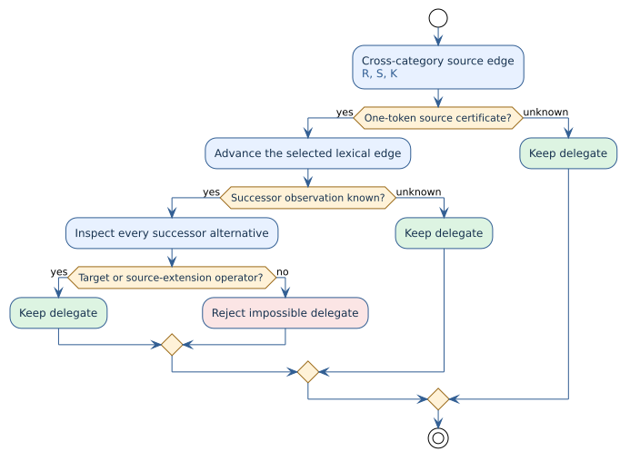

# Certified one-token cross-category prefix dispatch

PraTTaIL preserves every parse still supported by lexical and grammatical
evidence. A `CrossCatLhs` transition starts parsing a source category so that a
following operator may construct a different result category. It must not be
discarded merely because another parse looks more likely or has a better
weight. This note describes a narrower, negative-only optimization: a
grammar-derived certificate can prove that a particular lexical edge cannot
start a successful transition.



## Why the certificate is needed

Rholang includes `PCostStackCons . sig:CostSig, tail:CostStackChain |- sig
"::" tail : Proc`. The source category has a `CostSigGround` production whose
operand is a `Name`; a `Name` can begin with an identifier. Consequently the
`Proc` parser must
consider `CostSig` when it sees an identifier. Previously, a distant `::`
anywhere in the remaining source could keep that speculative worker alive,
even when the token immediately after the identifier already refuted the
`CostSig` interpretation. The large Regex application then exhausted its
semantic-key resource while parsing unrelated data-definition-language (DDL)
text.

In the focused regression, the unchanged 687-line application previously
reached the 1,048,576-key limit after about 837 seconds of parsing. With the
certificate gate, the same parse completed in 3.64 seconds under that limit;
these figures exclude Rust compilation and are observations of this fixture,
not a claimed bound for every grammar.

Changing `::` or adding a leading marker would change the authored language.
The fix instead asks a question about the existing grammar before creating the
worker.

## Certificate and rejection rule

Let $`R`$ be the result category, $`S`$ the source category, $`K`$ the selected
first lexical kind, $`T(R,S)`$ the declared operators that turn an $`S`$ left
operand into $`R`$, and $`F(S,K)`$ a conservative set of operators that can
extend an $`S`$ expression after its first atom. A certificate
$`C(S,K)`$ is issued only if **every** $`K`$-starting source prefix is a
complete one-token atom or a transparent projection of one, and every longer
derivation first consumes an operator in $`F(S,K)`$. Projection cycles and
unclassified prefixes prevent certification.

For the selected edge, let $`v`$ be its successor node and $`A(v)`$ the
fixed-operator spellings offered by all lexical interpretations at that node.
A certified delegate can be rejected
only when:

```math
C(S,K) \;\land\; A(v)\cap\bigl(T(R,S)\cup F(S,K)\bigr)=\varnothing.
```

If the edge, successor, grammar shape, or lexical observation is unknown, the
delegate stays. This is a proof of impossibility, not a fixed candidate-count
limit or a ranking decision. In the Rholang example, `Ident` through `Name`
is the one-token atom, `::` belongs to $`T(\mathrm{Proc},\mathrm{CostSig})`$, and
`-o` and `(*)` are source extensions. An identifier followed by an unrelated
token cannot satisfy the rule, even if a `::` occurs later in another DDL
declaration. An identifier followed by `::`, `-o`, or `(*)` remains viable.

The certificate does **not** claim that every `CostSig` is one token.
`#` followed by a `Proc`, quoted names, and grouped signatures retain their
ordinary parsing paths; their starts are uncertified unless a separate exact
certificate can be derived. In particular, a `#Proc` body may contain `|`,
so a global row-separator scan would be unsound here.

## Iterative implementation

The generator traverses source categories with an explicit worklist. For an
identifier start, it accepts a synthetic variable atom, follows transparent
projection edges, and accumulates all infix/postfix continuations from each
visited category. A rule that could begin with the selected identifier but is
not proved atomic, or a repeated projection category, makes the certificate
unknown. The transition then remains unchanged. The traversal reuses the
existing atomic-shape classifier, synthetic rules, and infix classifier; it
does not introduce another lexer, parser, or derivation algorithm.

A fixed terminal is not automatically disjoint from an identifier: an
unreserved or contextual keyword can have an `Ident` co-accept, and a longer
terminal such as `name!` can overlap an identifier prefix. Accordingly,
identifier-starting fixed openers and native literal families whose lexer
behavior may be customized make this certificate unknown. The generator uses
PraTTaIL's shared identifier-start predicate for fixed openers. Punctuation
openers such as `#` and `(` remain disjoint from `Ident`.
This conservative rule keeps the proof premise valid for grammars beyond
Rholang, at the cost of leaving some safe but unproved cases to the ordinary
dispatcher.

At runtime the generated predicate checks the selected lexical edge's own
`next_pos`. This matters for a token lattice: two alternatives at the same
node may lead to different successor nodes. At the successor it checks both
the primary interpretation and every lexical alternative. The gate is used
at singleton and multi-branch prefix dispatch and at both lexical-fork
`CrossCatLhs` arms. The established operator scan remains a conservative
fallback for uncertified cases.

The executable contract is in
[`prefix_policy.rs`](../../../prattail/src/wpda_transitions/prefix_policy.rs)
and the certificate generation in
[`kind_dispatch.rs`](../../../macros/src/gen/runtime/wpda_codegen/kind_dispatch.rs).
The no-loss implication is proved, without admitted facts, in
[`CertifiedCrossCatPrefix.v`](../../../formal/rocq/prattail_wpda_runtime/theories/CertifiedCrossCatPrefix.v).
Its premise is intentionally explicit: a certificate issuer must establish
the one-token-base and complete-extension conditions. The focused tests
exercise the issuer, the immediate-successor rule, and lexical alternatives;
the full Rholang application is the integration regression gate.
