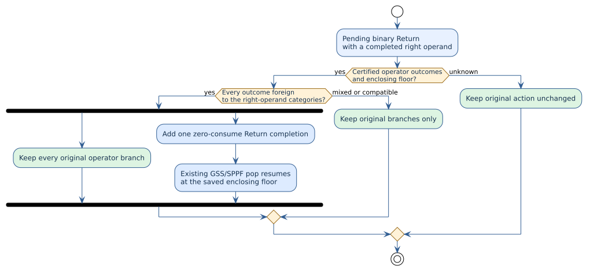

# Typed completion of a Pratt right operand

PraTTaIL's canonical generalized parser keeps competing operator readings
until grammar evidence rejects them. A binary infix rule uses a `Return` frame
while its right operand is being parsed. The frame saves the binding-power
floor at which the *completed* rule may resume in its enclosing expression.
This note specifies when the right operand can finish before an operator that
changes its category.



## The failing derivation

The Rholang cost syntax declares `CostSigTransfer` as a right-associative
`CostSig` binary rule and declares `::` constructors whose left operand is a
`CostSig` but whose results are `CostStackChain` or `Proc`. Thus
`alice -o bob :: ()` must allow `alice -o bob` to complete as a `CostSig`,
then give `::` to the enclosing stack rule. This is not a special rule about
`::`: any grammar may contain an operator that changes the result category.

The built-in walker trace showed the precise failure. At the `::` token the
pending `CostSigTransfer` `Return` was at right-operand floor 2, while the
saved enclosing floor was 0. The engine offered both `::` outcomes as a
fork, but no zero-consume completion of the pending rule. Both operator
branches consumed `::` inside the `CostSig` operand and eventually died;
the enclosing stack rule never received that token.

## Certified decision

Let $`B`$ be the completed right-operand category, $`E`$ the set of expected
right-operand categories of the still-viable binary rule members, and
$`O`$ the operator candidates offered at this input position. Define
$`C(c,e)`$ to mean that category $`c`$ satisfies expected category $`e`$
directly or through a declared, valid single-hop coercion. The parser adds
one epsilon completion reading only if:

```math
\begin{aligned}
&\text{frame is a binary Return} &&\land\; \exists e\in E:\;C(B,e)\\
&\land\; O\ne\varnothing &&\land\;\text{the enclosing category accepts an operator in }O
   \text{ at the saved floor}\\
&\land\;\forall o\in O,\;\forall e\in E:\;\neg C(\mathrm{result}(o),e).
\end{aligned}
```

The outcome category of each candidate is taken from the existing operator
action or lexical-alternative branch, not inferred from token spelling.
An unrecognized action shape, absent signature, non-binary member, missing
body category, or unverified lexical edge makes the decision *unknown* and
leaves the engine action unchanged. Synthetic factored rule IDs are expanded
with an explicit worklist. No recursive traversal is added.

When the condition holds, the walker enqueues an `Unwinding` descriptor with
the same input position, GSS node, SPPF spine, and unit transition weight.
It then dispatches **all** original operator candidates, unchanged. The
existing `Return` pop fires the pending rule and resumes at its saved outer
floor; ordinary grammar and action checks decide whether the resulting path
can consume the operator. The new path is an addition, not a replacement or
a top-`k` selection.

The cheap frame/action and outer-floor tests run before flattening an SPPF
spine. Only an eligible binary `Return` needs that inspection. The extra
descriptor remains subject to the walker's existing parse-item and forest
limits; this adds neither a recursive parser call nor another tokenization
pass.

The universal condition is necessary for precedence safety. If the same
token has both an outcome compatible with the right operand and an outcome
that is not, an unrestricted completion would allow the *compatible*
operator to be reparsed outside the pending rule. That could invent a
reading analogous to `(1 + 2) * 3` when the grammar requires `1 + (2 * 3)`.
Mixed overloads require candidate-specific continuation; this conservative
rule does not claim to implement that separate mechanism. It preserves their
original branches rather than using one overload as evidence for another.

## Verification and executable contract

[`TypedReturnCompletion.v`](../../../formal/rocq/prattail_wpda_runtime/theories/TypedReturnCompletion.v)
models the exact uniform-foreign decision and proves that every existing
candidate remains, a completion can only be offered under its type and
enclosing-floor premises, a compatible candidate blocks unrestricted
completion, and the new edge consumes no input. Rocq reports each theorem
closed under the global context. The model deliberately treats grammar
signatures and category reachability as inputs; the Rust implementation reads
those inputs from the installed parser image.

The implementation is
[`cgll_pure_binary_return_can_complete_before_operator`](../../../prattail/src/wpda_walker.rs),
in the canonical walker rather than a Rholang-specific parser. The generated
Rholang syntax and stack rules remain unchanged. The
[`rholang_cost_syntax` tests](../../../languages/tests/rholang_cost_syntax.rs)
cover the ungrouped transfer stack, variations in operand names, and the
right-associative transfer chain. An exhaustive finite property test covers
every compatibility relation and every pair of outcome/expected subsets in a
three-category universe, including the mixed-overload counterexample.
Existing calculator precedence tests guard the ordinary same-category case.
