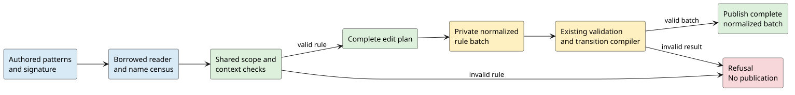

# Explicit rewrite families

A rewrite family describes a child transition inside a fixed constructor context.
The shared checker converts this declaration into an edit plan for existing rewrite premises.
It does not execute transitions or construct a second syntax tree.



## Surface meaning

An explicit family has the type `Rewrite(P)` or an ordered function type that ends in `Rewrite(P)`.
Here, `P` denotes the endpoint category.
Function domains denote the types of lexical arguments.

```text
Body . f:[Name -> Rewrite(Proc)] |-
  (New ^x.(s (f x))) ~> (New ^x.(t (f x)));
```

The source projection `s` selects the child before its transition.
The target projection `t` selects the child after that transition.
Both projections must refer to the same declared family and the same ordered lexical arguments.
Each family must occur exactly once on each side.

The corresponding ordinary rule has fresh source and target metavariables.
The compiler appends the source type and the existing transition premise.
The target remains a derived premise variable.

```text
Body . child_source:Proc, | child_source ~> child_target |-
  (New ^x.child_source) ~> (New ^x.child_target);
```

The names in this example are explanatory.
The allocator selects names that do not collide with authored names or other generated names.
Existing runtime substitution, capture handling, and transition execution retain their contracts.

The canonical context decoder recognizes the same explicit family marker in rule-context data:

```text
["typed", "f", ["arrow", "Name", ["rewrite", "Proc"]]]
```

Each domain and the result must pass the existing ordinary type decoder.
Nested arrows and collections retain their complete canonical values.
The family marker is valid only at the terminal rewrite-context codomain.
Ordinary term types, equation contexts, and intrinsic output types retain their existing rules.
A category named `Rewrite` remains an ordinary category.

This syntax check does not establish executable support for every type.
The executable context decoder still rejects `multi`.
The generated live DDL transports complete context types.
The canonical compiler adapter normalizes families before ordinary context compilation.
[Runtime properties](../../dovetail-runtime/tests/rewrite_families.rs) compare canonical family execution with independently authored ordinary rules.

## Context transport

The elaborator stores each rewrite context type as a validated canonical value.
The type payload is private and has no mutable accessor.
Canonical encoding copies this payload exactly.
Ordinary term sorts and intrinsic output bindings retain their existing representation.

The existing `.module` parser accepts these context type forms:

| Source type | Canonical value |
|---|---|
| `A` | `"A"` |
| `[A -> B]` | `["arrow", "A", "B"]` |
| `A*` | `["multi", "A"]` |
| `HashBag(A)` | `["bag", "A"]` |
| `Set(A)` | `["set", "A"]` |
| `List(A)` | `["vec", "A"]` |
| `Map(A, B)` | `["map", "A", "B"]` |
| `PathMap(A, B)` | `["pathmap", "A", "B"]` |
| `Rewrite(A)` | `["rewrite", "A"]` |

Ordinary constructors can nest without losing their complete arguments.
The family marker retains the terminal-codomain restriction described above.
Repeated postfix markers remain distinct.
For example, `[A -> B]*` differs from `[A -> B*]`.

The parser uses explicit frames and a value stack.
Each finish frame combines completed children in their original order.
The renderer also uses explicit frames and preserves constructor names, argument order, brackets, and postfix positions.
Neither operation requires recursive calls for nested types.

Context type names use the existing token spellings.
Thus, canonical names such as `Types`, `Data`, `Theory`, and `Nil` retain their names in this position.
The canonical identifier validator still rejects reserved Rust keywords.
Quoted strings and numeric literals cannot supply type names.
Bare `Rewrite`, `Map`, and `PathMap` remain category names.

The wire decoder accepts complete canonical context types and the existing shallow sort tags.
Legacy category, bag, set, and list payloads retain their exact canonical values and context order.
Intrinsic outputs still use the existing ordinary sort decoder.

Source and wire context types have a maximum depth of 256.
A category has depth one.
Each constructor adds one to its deepest child.
Tag strings and wire framing do not add type depth.

Wire depth admission runs before type validation.
If an input exceeds the depth limit and also has malformed types, the depth error takes precedence.
Direct canonical validation does not inherit this source and wire restriction.

## Shared checker

[`plan_rewrite_families`](../src/rewrite_family.rs) accepts borrowed node, name, and sort handles through `RewriteFamilyReader`.
It returns a complete `RewriteFamilyPlan` or one error.
The reader must describe immutable, finite, admitted source trees.
Repeated handles represent separate occurrences.

The checker first examines explicit family projections.
Their declarations supply the endpoint types, including when a projection occupies the root.
Other nodes use the existing constructor signature for type information.
The checker rejects disagreement with an expected type.

Matching unknown child types disable replacement throughout that child subtree.
Later constructor inference cannot enable replacement again.
The checker still compares the subtree and includes its names in the census.
An unknown child does not disable its typed siblings.
Only the root projection can use a declared family result without parent type evidence.

The paired traversal compares constructor positions and ordinary payloads.
It gives each paired binder a separate lexical identity.
Arguments resolve to the nearest active binder, including typed ambient inputs.
Arguments must be distinct and must include every binder introduced along the occurrence path.
Ambient inputs need not all occur in the argument list.

The checker preserves each unique binder spelling.
It renames repeated spellings only when no surviving authored variable position refers to that spelling.
This preserves existing typed-context aliases and premise references.
Ambiguous references cause refusal with both source locations.
The AST diagnostic also identifies the binder name and its index within the abstraction.

Computational metasyntax disables family replacement throughout its descendants.
This includes mapping, zipping, substitution, and indexed operations.
The traversal still examines their pattern operands for names and forbidden family uses.
Literal payloads and opaque guard data do not become pattern operands.

## Reader contract

| Observation | Required meaning |
|---|---|
| `kind` | Describe the original node without traversing its children. |
| `child_count`, `child_at` | Enumerate all pattern children in their original operand order. |
| `binder_at` | Enumerate abstraction binders in original order. |
| `variable_count`, `variable_at` | Enumerate additional variable reads and declarations in the node payload. |
| `same_header` | Compare node kinds and every non-child payload exactly. |
| `same_name`, `name_is` | Use the same identifier equality as the destination compiler. |
| `valid_sort` | Check the complete type against the authoritative signature. |
| `node_sort`, `child_sort` | Supply the existing constructor result and parameter types. |
| `abstraction_sorts` | Supply the declared binder domain and body codomain. |

`Variable` nodes expose their primary name through `kind`.
They have no pattern children or additional variable fields.
Application names are constructor labels unless an explicit family declaration identifies a projection operand.
Constructor labels enter the reserved-name census but do not count as variable references.

Additional variable observations include collection remainders, index variables, substitution variables, and map parameters.
The adapter separately supplies every structured premise read and declaration.
This includes transition targets, intrinsic outputs, and quantified parameters.
It also reserves every constructor label, including labels absent from the rule.

The checker obtains abstraction body types directly from `abstraction_sorts`.
It does not depend on a second abstraction interpretation in `child_sort`.
An adapter must preserve optional parameter distinctions and existing legacy declaration normalization.
The AST adapter collects the existing declaration leaves once per constructor.
Indexed access preserves declaration order, complete type handles, and optional flags.
Generated Rust field order does not determine semantic parameter order.

A native collection element must identify a complete declared category.
A qualified category path retains the existing lookup behavior.
Nested generic carriers and associated types provide no child-sort evidence through the existing shallow lookup.
The adapter preserves those ordinary subtrees and refuses family holes beneath them.
Map entries also require complete entry-sort evidence.

## Edit plan and publication

An occurrence number is the zero-based preorder position in the original pattern.
The left and right patterns have separate counters.
Every original pattern node counts, including nodes inside a replaced projection.
`subtree_end` is the exclusive occurrence number after that projection subtree.

An adapter can consume the original subtree before replacement.
Alternatively, it can replace the root and advance directly to `subtree_end`.
Both methods preserve all later edit positions.
Binder edits also identify the binder index within an abstraction.

The plan stores family results in declaration order.
Adapters remove explicit family declarations, preserve ordinary context entries, and append typed source inputs.
They preserve authored premises and append generated transition premises in declaration order.
Existing validation and runtime limits still apply to the normalized result.

An empty declaration roster returns an empty plan without reading either pattern.
Thus ordinary rules can retain different left and right sides.
Adapters must apply edits privately and publish only after the complete rule batch succeeds.

## Name allocation and limits

Generated names use the prefix `__mettail_rewrite_` and a canonical decimal counter.
The counter advances before a candidate can be returned.
A reserved candidate causes another checked advance.
The shared counter prevents collisions between generated binders, sources, and targets.

The final counter value cannot produce a name because its successor is not representable.
Counter exhaustion and allocation failure return errors without a plan.
All checker vectors use fallible reservations.
The checker does not impose a new language-specific capacity or replace existing input admission limits.

## Verification boundary

The [Rocq models](../../formal/rocq/rewrite_family/README.md) contain 206 theorem statements across fifteen modules.
The extraction maps every theorem to a behavior group.
The models distinguish authored family semantics from existing transition-premise semantics.

The [checker tests](../tests/rewrite_family.rs) cover arbitrary signatures, nested contexts, declaration order, lexical scope, collisions, and refusal cases.
The allocator tests compare candidate selection with an independent finite oracle and exercise counter exhaustion.
These checks establish the shared checker boundary.
Each source adapter must also establish its reader contract, complete name census, edit correspondence, and existing compiler behavior.

The [AST adapter tests](../../ast/tests/rewrite_families.rs) compare normalized output with independently authored ordinary rules.
They cover nested binders, declaration order, complete types, optional slots, premise names, raw identifiers, and atomic batch failure.

The macro and reconstruction entrypoints invoke the same adapter after composition.
The [generated-language tests](../../languages/tests/rewrite_families.rs) compare macro and reconstruction fingerprints.
They also execute declared transitions under nested binders through the existing Dovetail report API.
The tests require complete reports, exact result keys, and transition-firing evidence.
The structural `normalize()` method retains its existing purpose and does not execute general directed rewrite rules.

The [canonical adapter](../../mettail-elab/src/theory_compile/rewrite_family.rs) supplies borrowed observations to the same planner.
Canonical strings remain variables, including names that match constructor labels.
The adapter uses registered sort identities and ordered descriptor fields.
It removes family declarations and appends typed source inputs and transition premises in declaration order.
The existing compiler allocates target variables with the Derived role.
The public lowering boundary validates the private result before publication.

The [canonical context tests](../../mettail-elab/src/schema/rule_context.rs) cover exact ordinary values, ordered complete family types, and invalid nested markers.
They also check equation and intrinsic exclusion and a 2048-level context on a 256 KiB thread stack.

The [transport tests](../../mettail-elab/tests/rewrite_context.rs) compare canonical, source, and wire context values with independently generated inputs.
They check keyword names, exact legacy payloads, argument order, nested-marker refusal, and the source and wire depth boundary.
Deep rendering and cleanup also run on a 256 KiB thread stack.
These tests establish transport behavior, not executable family normalization or registered-sort resolution.

Run the focused AST and generated-language tests from the repository root:

```sh
cargo test -p ast --test rewrite_families
cargo test -p ast --lib rewrite_family::tests
cargo test -p languages --no-default-features --features dovetail-codegen --test rewrite_families
cargo test -p mettail-elab --lib schema::rule_context::tests
cargo test -p mettail-elab --test rewrite_context
```

These generated-language tests establish Dovetail execution and propagation.
The canonical runtime properties check one-step premise execution through the public compiler and existing transition matcher.

The proofs do not establish that an external guard evaluator tolerates arbitrary numeric slot changes.
They do not add first-class rewrite values or family transitions inside computational metasyntax.

The generated DDL uses separate context type and binding categories.
Ordinary term sorts and intrinsic output bindings keep their existing categories.
Named tokens carry category names and type constructor words through existing generated token capture.
These tokens have priority zero and preserve the host keyword reservation policy.
Bare constructor words remain category names when no argument list follows.

Structural lowering selects legacy wire tags only for an outer category or a shallow bag, set, or list.
Extended types contain canonical children in authored order.
The existing wire decoder checks depth before type validation and publication.
The lowering uses the existing task stack and both existing output carriers.
The [generated transport tests](../../rholang-runtime/src/ddl_ast/context_tests.rs) check these boundaries.

## Runtime binder projection

The transition matcher identifies each substitution key by its activation and variable ID.
An activation identifies one rule invocation or local comprehension scope.
Projection visits declared variables in order and retains each present key from the root rule activation.
The variable role does not determine scope.
Thus, a matched abstraction binder remains available when the runtime reconstructs the output.

Fresh comprehension activations keep local parameter keys outside the projected domain.
Grounding can still read local terms needed to compute a retained root value.
The existing grounding operation and publication boundary remain authoritative.
If grounding fails, projection returns the error without a partial result.

The ordinary-rule regression reproduces this requirement without explicit family syntax.
Generated runtime properties compare family rules with independent ordinary-premise rules and expected output graphs.
The projection properties also check declaration order, duplicate-key precedence, all variable roles, local scope separation, and exact refusal.

```sh
cargo test -p mettail-elab --lib theory_compile::rewrite_family::tests
cargo test -p dovetail-runtime --lib root_projection
cargo test -p dovetail-runtime --test rewrite_families
```
